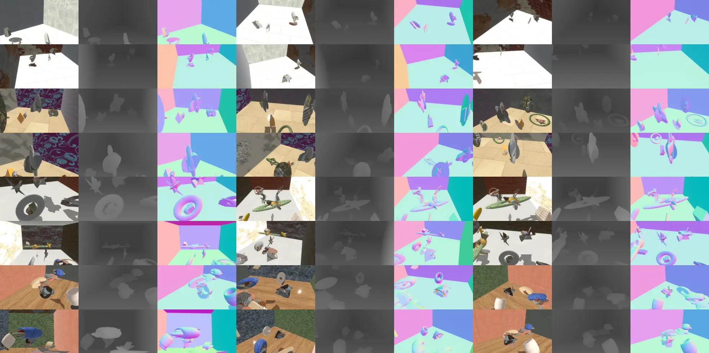
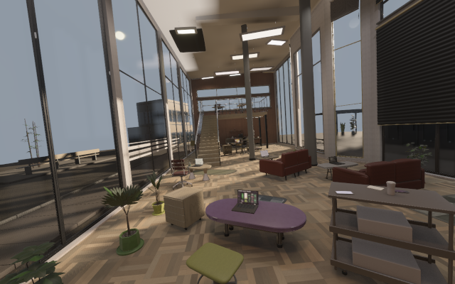
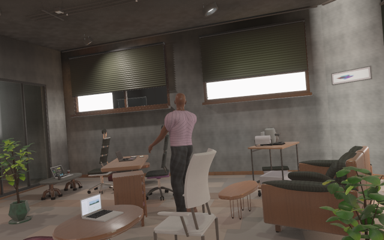
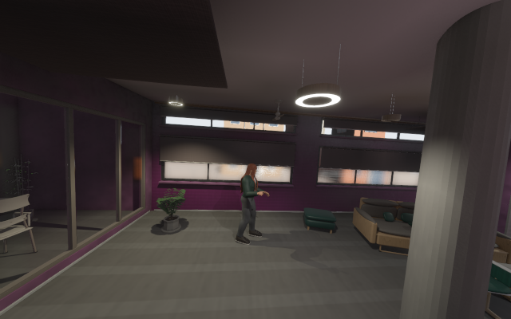
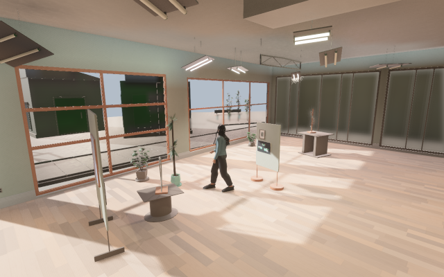
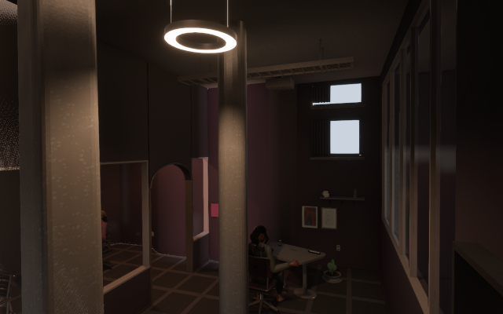
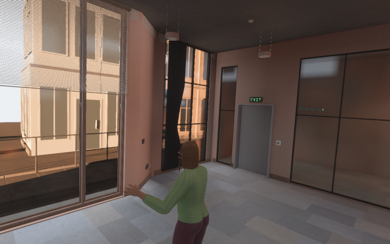
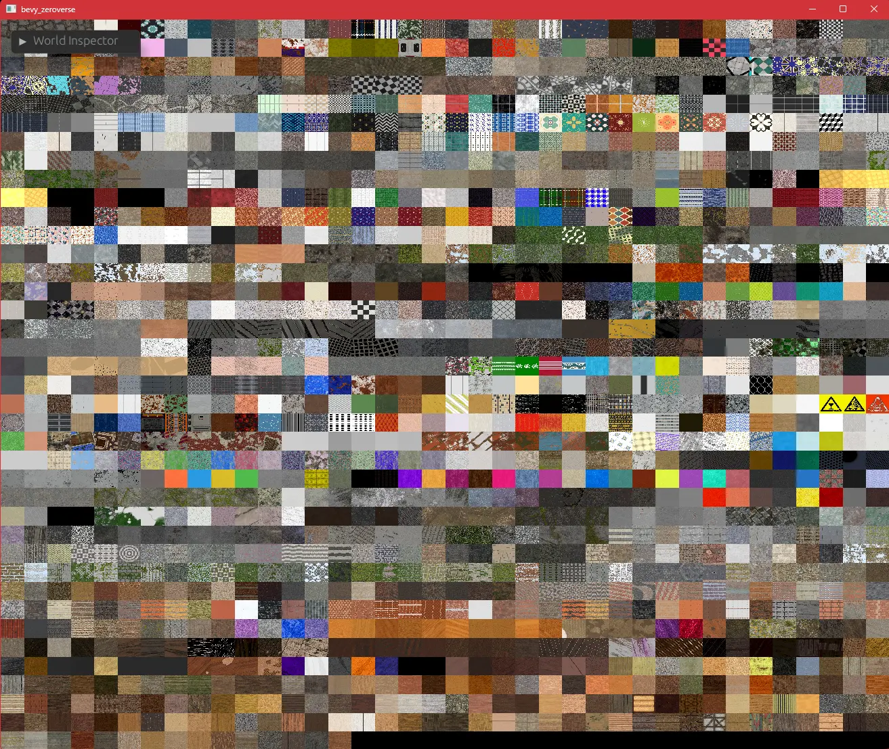

# bevy_zeroverse ♾️

[](https://github.com/mosure/bevy_zeroverse/actions/workflows/test.yml)
[](https://crates.io/crates/bevy_zeroverse)
[](LICENSE)

Bevy Zeroverse generates synthetic datasets for multi-view 3D reconstruction.
Capture synchronized views of a furnished room or a procedural object, with
camera calibration and pixel-aligned geometry and labels.

[Open WebGPU Studio](https://mosure.github.io/bevy_zeroverse/?scene_type=procedural-indoor&indoor_seed=7&num_cameras=4&camera_grid=true&regenerate_ms=0) ·
[Generate a dataset](#generate-a-dataset) ·
[Project gallery](https://mosure.github.io/bevy_zeroverse/project/) ·
[Whitepaper (PDF)](https://mosure.github.io/bevy_zeroverse/project/static/papers/bevy_zeroverse.pdf) ·
[Documentation](docs/README.md)

## Quick start

With Rust 1.97.1 or newer, install Scene Studio and open four views of room 7.

```sh
cargo install bevy_zeroverse --locked
bevy_zeroverse --indoor-seed 7 --num-cameras 4 --camera-grid
```

Run `bevy_zeroverse` alone to explore with the editor camera. **Apply changes**
rebuilds the current seed. **R** advances to the next room, **F1** hides the controls,
and **F11** toggles fullscreen. [Studio controls](docs/studio_controls.md)

For a fullscreen presentation with automatic scene changes, run `bevy_zeroverse --kiosk`.
[Open kiosk in the browser](https://mosure.github.io/bevy_zeroverse/?kiosk)

## Object Zeroverse

The original object scenes combine parametric primitives, mesh deformation and
sampled materials. The Python/PyTorch dataloader can generate these views during training.



```sh
bevy_zeroverse --scene-type object --num-cameras 4 --camera-grid
```

[Open object scenes in WebGPU Studio](https://mosure.github.io/bevy_zeroverse/?scene_type=object&num_cameras=4&camera_grid=true&regenerate_ms=8000)

## Procedural interiors

Room programs include shared offices, boardrooms, kitchens, cafés, table-service
restaurants, fitness rooms, cycling and yoga studios, volleyball gyms, changing rooms, music rehearsal rooms, laundromats, grocery stores, clothing stores, hallways, stair halls, courtyards, classrooms and
galleries. Each thumbnail opens the full native capture.

<table>
  <tr>
    <td width="33%" align="center">
      <a href="docs/gallery/s7-t0-c3-color.webp"></a><br>
      <strong>Mezzanine &amp; stairs</strong><br><sub>Seed 7 · camera 3</sub>
    </td>
    <td width="33%" align="center">
      <a href="docs/gallery/s8-t0-c3-color.webp"></a><br>
      <strong>Stepped breakroom</strong><br><sub>Seed 8 · camera 3</sub>
    </td>
    <td width="33%" align="center">
      <a href="docs/gallery/s6-t0-c1-color.webp"></a><br>
      <strong>Furnished reception</strong><br><sub>Seed 6 · camera 1</sub>
    </td>
  </tr>
  <tr>
    <td width="33%" align="center">
      <a href="docs/gallery/s4-t0-c0-color.webp"></a><br>
      <strong>Mixed-use interior</strong><br><sub>Seed 4 · camera 0</sub>
    </td>
    <td width="33%" align="center">
      <a href="docs/gallery/s2-t0-c3-color.webp"></a><br>
      <strong>Low-light workspace</strong><br><sub>Seed 2 · camera 3</sub>
    </td>
    <td width="33%" align="center">
      <a href="docs/gallery/s28-t0-c0-color.webp"></a><br>
      <strong>Classroom lighting</strong><br><sub>Seed 28 · camera 0</sub>
    </td>
  </tr>
</table>

### Capabilities

- **Architecture and placement** share a floor plan. Stairs, mezzanines, glazing and
  exterior scenery change sightlines. Furniture layouts leave space for doors and circulation.
- **Materials and lighting** come from the room seed. Cameras see the same
  parquet grain, upholstery weave and tinted glass under daylight and interior fixtures.
- **Camera rigs** mix room trajectories and ceiling mounts with pinhole or calibrated
  fisheye lenses. Baseline controls spacing and shared visibility.
- **Motion** uses one timeline for cameras, people and furnishings. AnnyBody people
  can hold a pose or follow ARDY text and waypoint prompts while chairs roll and doors open.

Cornell cube, simple room, semantic room and standalone human scenes are also available.

## Generate a dataset

From a checkout, run the headless generator to write 100 rooms as SafeTensors
chunks. This example captures four views per room at one instant.

```sh
cargo run --release --locked -p bevy_zeroverse_burn --bin zeroverse_gen -- \
  --scene-type procedural-indoor --output out/indoor_dataset --samples 100 --seed 0 \
  --cameras 4 --width 640 --height 480 --indoor-camera '{"baseline":0.5}' \
  --render-modes color depth normal semantic position co-visibility \
  --ov-mode disabled --no-ui
```

Use `--schematic` to add top-down views. The generator also exports distributions
of object counts, placements, lighting and camera parameters. Split training and
evaluation by room seed to keep related views together. [Dataset guide](docs/procedural_indoor_dataset.md)

For online training, the Burn bridge renders to WGPU tensors on the same device
and supports Vulkan-to-CUDA transfers on Linux. [GPU tensor API](docs/gpu_jit.md)

### Exports

| Output | What you get |
| --- | --- |
| RGB and cameras | Color images, image dimensions, lens models, intrinsics, poses and capture times |
| Indoor geometry | Depth in metres, view-space normals and world positions encoded relative to the primary-room bounds |
| Labels | Semantic classes and their color palette, oriented object boxes and human joints |
| Correspondence | Optical flow with validity masks and per-pixel co-visibility for rigs of up to 16 cameras |
| Room schematic | Metric top-down JSON, SVG and PNG with cameras, skeletons and optional prediction overlays |
| O-voxel | Primary-room surfaces and semantics for a single timestep with human and furnishing motion disabled |

Glass is a surface in geometric annotations by default. Use
`--annotation-glass through` to label the geometry behind it.

## MatSynth

Object scenes can also sample PBR material maps from MatSynth.



[Open the material grid in WebGPU Studio](https://mosure.github.io/bevy_zeroverse/?scene_type=object&material_grid=true)

<details>
<summary>Use MatSynth maps locally</summary>

Download the maps to `data/MatSynth`, then run these commands from the checkout.
The resize script uses NumPy, OpenCV and tqdm. [MatSynth download script](https://huggingface.co/datasets/gvecchio/MatSynth/blob/main/scripts/download_dataset.py)

```sh
python3 mat-synth/resize.py --source_dir data/MatSynth --dest_dir assets/materials
cargo run --locked -- --scene-type object --material-grid
```

</details>

## Credits

[Zeroverse](https://github.com/desaixie/zeroverse) ·
[LGM](https://github.com/3DTopia/LGM) ·
[MatSynth](https://huggingface.co/datasets/gvecchio/MatSynth)
