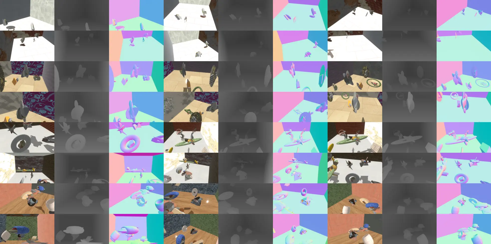
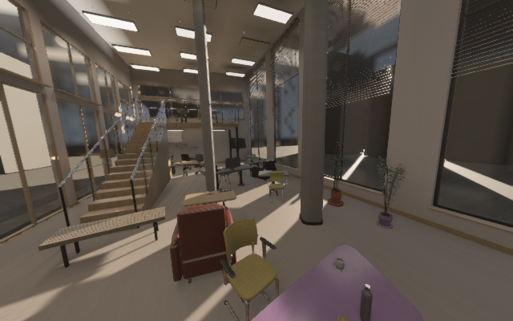
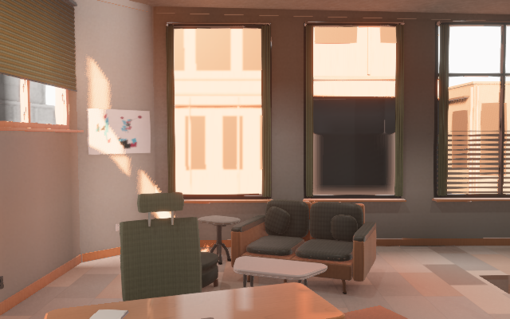
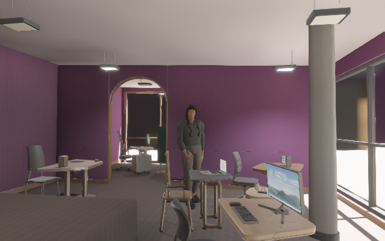
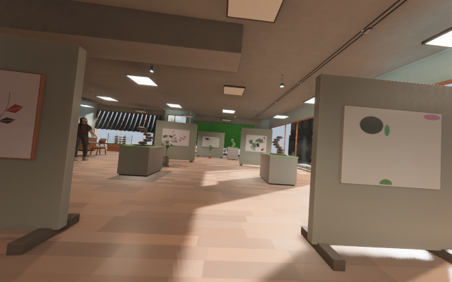
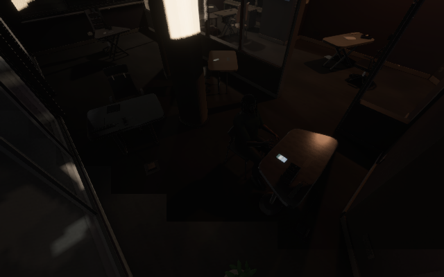
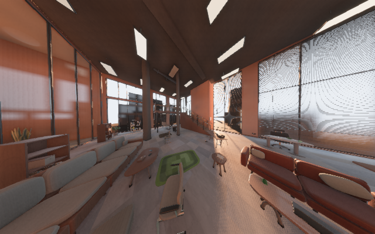
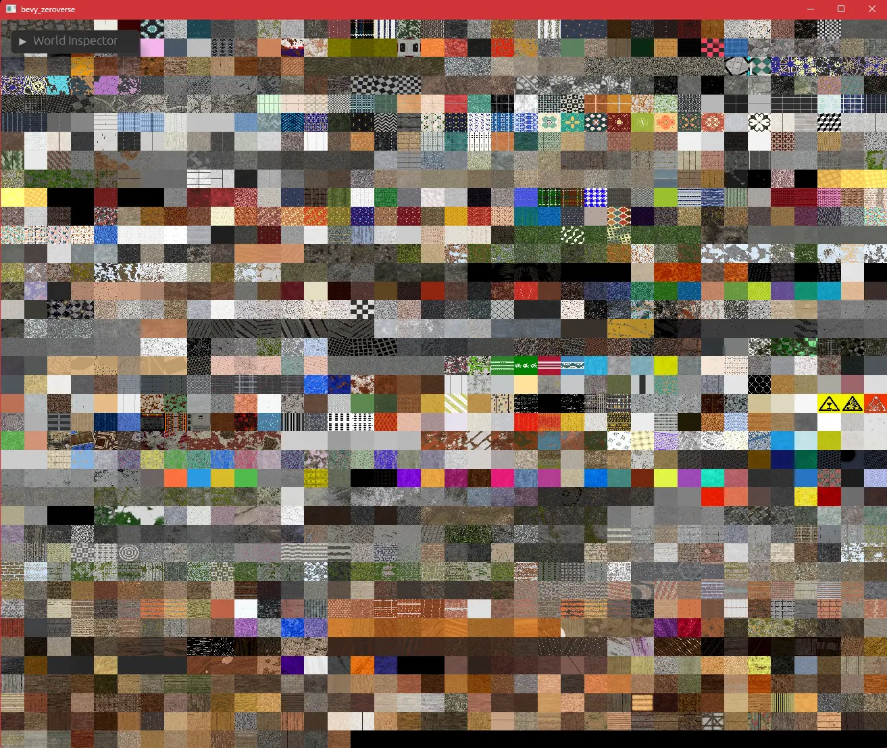

# bevy_zeroverse ♾️

[](https://github.com/Mosure/bevy_zeroverse/actions?query=workflow%3Atest)
[](https://crates.io/crates/bevy_zeroverse)
[](LICENSE)

Bevy Zeroverse is a procedural synthetic reconstruction dataset generator.
Sample textured primitive objects or furnished interiors, capture synchronized
views, and export calibrated cameras with aligned images, geometry and labels.

[Project page](https://mosure.github.io/bevy_zeroverse/project/) ·
[WebGPU viewer](https://mosure.github.io/bevy_zeroverse/?scene_type=procedural-indoor&indoor_seed=7&num_cameras=4&camera_grid=true&regenerate_ms=0) ·
[Whitepaper](https://mosure.github.io/bevy_zeroverse/project/static/papers/bevy_zeroverse.pdf) ·
[Documentation](docs/README.md)

## Object Zeroverse

The original object scenes combine parametric primitives, mesh deformation,
randomized materials and multi-view capture. The Python/PyTorch dataloader can
generate samples online.



```sh
cargo run --bin viewer -- --scene-type object --num-cameras 4 --camera-grid
```

[Open object scenes in the WebGPU viewer](https://mosure.github.io/bevy_zeroverse/?scene_type=object&num_cameras=4&camera_grid=true&regenerate_ms=8000)

## Procedural interiors

<table>
  <tr>
    <td width="33%" align="center">
      <a href="www/project/static/media/architecture/s7-t0-c3-color.webp"></a><br>
      <strong>Mezzanine &amp; stairs</strong><br><sub>Seed 7 · camera 3</sub>
    </td>
    <td width="33%" align="center">
      <a href="www/project/static/media/architecture/s8-t0-c3-color.webp"></a><br>
      <strong>Stepped breakroom</strong><br><sub>Seed 8 · camera 3</sub>
    </td>
    <td width="33%" align="center">
      <a href="www/project/static/media/architecture/s6-t0-c1-color.webp"></a><br>
      <strong>Furnished reception</strong><br><sub>Seed 6 · camera 1</sub>
    </td>
  </tr>
  <tr>
    <td width="33%" align="center">
      <a href="www/project/static/media/architecture/s4-t0-c0-color.webp"></a><br>
      <strong>Mixed-use interior</strong><br><sub>Seed 4 · camera 0</sub>
    </td>
    <td width="33%" align="center">
      <a href="www/project/static/media/architecture/s2-t0-c3-color.webp"></a><br>
      <strong>Low-light workspace</strong><br><sub>Seed 2 · camera 3</sub>
    </td>
    <td width="33%" align="center">
      <a href="www/project/static/media/architecture/s28-t0-c0-color.webp"></a><br>
      <strong>Classroom lighting</strong><br><sub>Seed 28 · camera 0</sub>
    </td>
  </tr>
</table>

Selected native captures at the start of each camera trajectory, with no exposure
correction. Click a thumbnail for the full image. The project page includes more
rooms, synchronized views, matching annotations, floor plans and distributions.

## Capabilities

Loose furnishings and supplies vary in position, rotation and physical size before
clearance checks. Shelves mix dishware and pantry sizes; pillows vary independently;
ceiling fixtures share a construction style with varied dimensions and spacing.


- **Object scene programs:** parametric primitives, mesh deformation, rotation
  augmentation and material sampling, with Cornell cube and simple room scenes.
- **Continuous scene programs:** polygonal footprints, cut-ins, chamfered corners,
  sloped and raised tray ceilings, arches, pillars, floor levels and mezzanines.
  Acoustic panels, coffers, suspended grids, round/square/rectangular ducts, ventilation terminals, conduit,
  sprinklers and trusses vary overhead detail. Exposed framing includes deep
  rafters, purlins and suspended services; mezzanines vary stair construction,
  structural supports and guardrail profiles.
  Windows include shaped glazing, tints, partial frosting, blinds and curtains;
  exterior streets, planted courtyards and multi-storey buildings with varied
  wings, setbacks, roof forms and facade bays provide context beyond the glass.
  Room-wide joinery programs vary skirting and crown heights, section profiles,
  finishes and presence. Glazing varies piers, sill and header levels, unequal
  panes, transom counts, sash sections, seals and projecting sill materials.
- **Functional interiors:** offices, kitchens and kitchenettes, cafes, cafeterias,
  classrooms, lecture halls, elevator landings, showrooms and galleries. Service,
  seating and circulation areas have placement and clearance constraints. Lecture
  halls mix chair-only seating with tiered shared desks; cafeterias mix small
  dining groups with tables seating multiple people on both sides. Row spacing,
  seat position, rotation and vacancies vary while preserving clear passages. Doors
  and cabinetry vary their mechanisms, hardware, materials and opening states.
- **Procedural furnishings and appearance:** 106 item kinds, multipart furniture,
  task-conditioned tabletop groups, multi-monitor workspaces, coordinated wall
  galleries, 17 plant growth habits, connected equipment and fixtures. Continuous
  construction and finish programs vary furniture supports, shaped upholstery,
  dyed yarns, timber treatments, concrete, glass and lighting. Ceiling fixtures,
  floor lamps and task lights vary their bulbs, hollow shades, articulated supports,
  recesses, aim directions and independently finished trims. Mounted exit signs,
  fire alarms, ceiling detectors, manual pull stations, speakers and suspended or
  wall-mounted multicolored string lights add room services. Floor finishes vary
  plank/tile structure, herringbone and chevron parquet, hexagonal tiles,
  seamless mineral finishes, mixed tile/plank stock, carpet dye fields, staggered
  joints, independently sampled physical pattern sizes, regional wear and
  furniture-bearing area rugs, with floor outlets and
  routed cables. Cabinets, kitchen appliances, clocks, wall shelves and presentation
  equipment vary construction independently of surface finishes. Walls mix quiet
  paint with washed, woven and patterned wallpaper surfaces;
  metal and polymer finishes vary grain, polish, peening and roughness.
  Architecture and
  furnishings need no downloaded mesh or texture catalog. Power cables follow
  collision-checked gravity curves, including floor contact. Daylight-aware
  exposure and native soft sun shadows retain surface detail in bright rooms.
  Supported PBR recipes bake once on the GPU by default, with CPU fallback.
  Screens, whiteboards and artwork sample content independently of shared furniture
  finishes, with varied composition, typography, color, physical aspect and placement.
  Finite, separately labelled sky geometry closes window views without changing
  primary-room reconstruction bounds. RGB exposure is adjustable in Scene Studio.
- **Calibrated multi-view cameras:** configurable perspective intrinsics, including
  a 28–145° vertical FOV default distribution, primary-room placement,
  collision-checked trajectories and adjustable baselines with shared-view constraints.
  Ceiling-mounted CCTV cameras can mix with room cameras, using downward-facing,
  calibrated fisheye or wide rectilinear lenses. Fixed mounts and opt-in ceiling
  trajectories preserve body and swept-path clearance around fixtures.
  Studio and schematic camera glyphs share compact, camera-indexed colors;
  prediction overlays use the matching color with dashed outlines.
  The baseline preset accounts for mounting height and unequal lens coverage;
  directed co-visibility and physical camera separation remain explicit in exports.
- **People and motion:** AnnyBody meshes with procedural clothing and optional
  ARDY text/waypoint motion. Cameras and people share a capture timeline; static
  scenes do not initialize motion models. Captures include calibrated pose joints.
- **Optional room motion:** chairs swivel or roll, doors and cabinets open, and
  blinds or curtains move on the capture timeline. Swept reservations keep accepted
  mechanisms clear of geometry and people; disabled motion adds no planning work.

Semantic-room and standalone-human scenes are also supported. The engine is
built with Bevy 0.20 and Rust, with native dataset generation, a WebGPU viewer, and
Python/PyTorch integration.

Capture RGB defaults to 2× supersampling below 1280×720 pixels, resolved by a GPU
area filter. Numeric annotations retain aligned final pixel-center rays and
categorical labels. `--ssaa-factor 1` disables it; 0 selects Auto and 2/3/4 force
a fixed factor. Output dimensions and camera calibration remain unchanged.

## Quick start

Run the native viewer using the repository's pinned `nightly-2026-08-31` Rust toolchain (crate MSRV
1.97.1). The pin keeps native and WebGPU builds on the qualified compiler.
Optional motion and SigLIP2 inference use Burn 0.22.1:

```sh
cargo run --bin viewer -- --scene-type procedural-indoor --indoor-seed 7 \
  --num-cameras 4 --camera-grid
```

Screens, TVs and phones use device-aware procedural content; whiteboards combine
handwriting and diagrams. Rugs have whole-surface textile designs, and artwork
varies composition independently from canvas, paper, paint relief and varnish.
Materials remain consistent across views and time, with bounded texture residency.

Native JIT training can use `bevy_zeroverse_burn::gpu::GpuLiveDataset` (feature
`gpu_tensor`) to render into Burn-owned buffers on the same device, retaining
full native quality without host image transfers. `cuda_interop` supports Linux
Vulkan → CUDA; `cuda_ipc` connects externally supervised renderer processes to
an existing training device. CUDA uses an owned device copy and published
dependencies without patches. Requested outputs are authoritative, including
RGB-only capture; explicit GPU sRGB conversion matches archive training inputs.
See the [tensor contract and benchmark](docs/gpu_jit.md).

Scene Studio uses Bevy 0.20 Feathers controls and the built-in pan-orbit camera
on native and WebGPU; it needs no egui, inspector or external camera plugin. **Apply changes**
keeps the selected seed; **Next / R** advances it. Editing does not regenerate.
Collapsible task groups and **Jump to group…** keep related controls together;
each page remembers its scroll position. **Capture & tools** groups output size,
timesteps and configuration import/export.
Camera baseline coordinates spacing, shared surfaces and gaze variation across
the requested camera count. **Moving cameras (%)** selects fixed or moving views
(default 100%); travel bounds apply to moving cameras while scene animation stays
independent. Continuous **lens preference/spread** controls include a live PDF
preview, separate from spatial baseline. Optional calibrated **fisheye lenses**
add seeded per-camera frequency, angular FOV preference/spread, distortion and
circular coverage, with aligned depth, flow, semantics and co-visibility.
Studio starts at 50% fisheye; library and dataset APIs remain pinhole unless
enabled explicitly.
The viewport selector offers **Editor camera**, **Capture grid**,
and **Room schematic**. Browser links omit default settings while preserving the
active seed, preview and pending edits.
Schematics distinguish pinhole and fisheye cameras, including their angular
coverage and downward-facing ceiling mounts, in the live view and exported diagrams.
**View & playback → Glass in annotations** selects glass surfaces (default) or
unrefracted geometry behind glass for depth, normal, position, semantic, optical
flow and co-visibility. RGB transmission is unchanged. The same policy is available
as `--annotation-glass through` or `?annotation_glass=through` and recorded in
exports (`annotation_glass`: 0 = surface, 1 = through in tensor datasets).

Generate a dataset with four views per room:

```sh
cargo run -p bevy_zeroverse_burn --bin zeroverse_gen -- \
  --scene-type procedural-indoor --output out/indoor_dataset \
  --samples 100 --seed 0 --workers 1 --chunk-size 16 \
  --cameras 4 --width 640 --height 480 --playback-steps 1 \
  --indoor-camera '{"baseline":0.5}' \
  --render-modes color depth normal semantic position co-visibility \
  --ov-mode disabled --no-ui
```

Add `--schematic` to export top-down diagrams at each capture timestep.

The native CLI requires a GPU but no display server. Capture waits for assets,
render pipelines and requested motion. People use the body assets in
`assets/burn_human`; set `--indoor-human-density 0` to generate interiors without them.

## MatSynth

Object scenes can sample PBR materials from
[MatSynth](https://huggingface.co/datasets/gvecchio/MatSynth). The original material
grid shows the texture variety available alongside the procedural indoor materials.



Download the maps using the dataset's
[download script](https://huggingface.co/datasets/gvecchio/MatSynth/blob/main/scripts/download_dataset.py),
then resize them into the local material directory:

```sh
python mat-synth/resize.py --source_dir <path-to-mat-synth> --dest_dir assets/materials
cargo run --bin viewer -- --material-grid
```

[Open the material grid in the WebGPU viewer](https://mosure.github.io/bevy_zeroverse/?material_grid=true)

## Exports

| Output | Contents |
| --- | --- |
| RGB and calibration | Color images, camera intrinsics, poses and capture times |
| Depth, normals and positions | Native float32 geometric annotations |
| Semantics and instances | Class labels, object bounds, primary-room AABB and human joints |
| Optical flow and motion vectors | Temporal correspondence, validity and visibility masks |
| Co-visibility | Per-pixel membership in up to 16 capture cameras |
| Room schematic | Metric top-down JSON/SVG/PNG with captured cameras, skeletons and optional prediction overlays |
| O-voxel | Primary-room surface geometry and semantics |

The versioned semantic vocabulary includes plants, phones, laptops,
monitors, bins, cables, outlets, ceiling fans and distinct furniture classes. Capture provenance
includes the complete label/color palette; existing class colors remain stable.
Consumers should read this palette rather than assume a fixed class count.

Exports support chunked or per-sample storage, resume validation and distributions
of object counts, placements, lighting and camera parameters. Glass is the first
surface in geometry annotations. O-voxel requires one timestep and disabled human
and furnishing motion. Split training and evaluation by room seed.

Materials, people and indirect lighting remain approximate; photographic realism
and downstream training gains require further evaluation.

## Credits

[Zeroverse](https://github.com/desaixie/zeroverse) ·
[LGM](https://github.com/3DTopia/LGM) ·
[MatSynth](https://huggingface.co/datasets/gvecchio/MatSynth)
