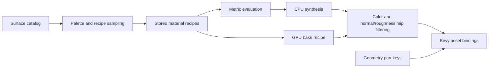

# Code organization and extension contracts

Module boundaries follow ownership of data, deterministic generation and render
resources. Public facades retain existing import paths; internal implementation
files can change without changing dataset schemas or reflection keys.

## Object categories and geometry

| Owner | Responsibility |
|---|---|
| `scene/procedural_indoor/objects/catalog.rs` | Stable object IDs, semantic classes, construction families and placement capabilities |
| `objects/routing.rs` | Exhaustive dispatch to a construction family |
| `objects/<family>/` | Seeded construction parameters and local geometry |
| `geometry/` | Shared metric primitives, sweeps, slabs and upholstered surfaces |
| `layout/`, `placement.rs` | Spatial relationships, support, allocation and collision constraints |
| `objects/audit/`, `validation/` | Independent realized-mesh and scene checks |

Append a category to the catalog, select its family and semantic class, and add
its construction program in that family. The same catalog drives enumeration,
semantic export and support/table-outline queries. Existing discriminants and
names are append-only: ordinal changes affect sampling and archived data.
`layout::ObjectKind` remains a compatibility re-export.

Builders receive the sampled object and append geometry to `Assembly`; they do
not install Bevy entities or start asynchronous work. Mesh ordering, part keys,
metric UVs and material slots are observable output. Placement randomness stays
in its existing domain-separated streams. Construction routing uses exhaustive
static matches and adds no registry allocation or dynamic trait dispatch.

## Materials

`Surface` is a stable binding role, such as floor or fabric. A `MaterialRecipe`
describes the sampled physical construction for that role. Multiple material
families can supply a role; a construction family does not need another surface
ID merely to introduce another weave, finish or substrate.

| Owner | Responsibility |
|---|---|
| `materials/surface.rs` | Stable slots, complete enumeration and substrate-map capability |
| `materials/program.rs` | Serialized recipe contract and public facade |
| `materials/program/palette.rs` | Correlated scene color priors |
| `materials/program/sampling.rs` | Seeded construction and floor specialization |
| `materials/program/evaluation.rs` | Recipe validation, metric evaluation and map sizing |
| `materials/<family>/` | Physical construction models and their replay tests |
| `materials/synthesis.rs`, `materials/gpu/` | CPU evaluation and GPU bake preparation/execution |
| `materials/mipmaps.rs`, `materials/filter.rs` | Encoding, transfer and coupled normal/roughness filtering |
| `materials/bindings.rs` | Used-material selection, resource ownership and synchronous/cooperative installation |

Add finish diversity in the corresponding typed recipe family. Add a binding
role only when geometry needs a distinct slot. Preserve the surface ordinal and
recipe array order. Keep CPU/GPU parity and mip filtering tests alongside changes
to evaluation; image appearance depends on those contracts even when the base
level is unchanged. `materials::Surface`, `IndoorMaterials`,
`program::PaletteProgram` and `program::SURFACES` retain their public paths.

## Cameras and lens models

The capture crate owns pixel/calibration contracts without a Bevy dependency.
`capture::calibration::LensModel::contract()` owns tensor IDs, schema versions,
model versions and depth conventions. Tensor export/import consumes that
contract; unknown IDs fail explicitly.

The Bevy camera subsystem separates:

- `camera/sampling.rs`: position, target and perspective-intrinsic sampling.
- `camera/playback.rs`: scene time and easing shared with object/human motion.
- `camera/trajectory.rs`: rigid camera paths, independent of projection.
- `camera/pinhole.rs`: calibrated shifted perspective projection.
- `camera/lens/`: angular sampling, source-view planning, lifecycle, photometric
  inheritance and resolve.
- `camera.rs`: ECS installation, scheduling and the compatibility facade.

A logical camera has one exported calibration, timeline and capture index.
Nonlinear source views are implementation details. New lenses need independent
projection/unprojection and visibility/flow oracles, export compatibility,
sampling/UI integration and render qualification. Sharing a trait is not enough
to establish those guarantees. Relocated reflected camera types explicitly keep
their original `bevy_zeroverse::camera::*` identities.

Indoor mixed rigs have separate `cameras/ceiling/{placement,trajectory,overview,room}`
modules for physical mounting, continuous rails, downward-content admission and
room-camera proposals. The planner retains fixed slot/lens/motion assignments.
Its overview gate uses a common downward cone; full-sensor overlap is checked
separately at every checkpoint. Surface ownership tolerates 0.1 mm ray roundoff;
mount, lens, path and pair clearances remain exact conservative tests. Bounded
room proposals favor the shared primary room and reuse independently deformed
clear paths during difficult packing, including usable mezzanine corridors.
Anchor ranking prefers distinct primary-room surfaces. `program/region.rs` selects
the primary region by actual floor area clipped to the exterior envelope, using
allocation-free signed clipping; camera, schematic and O-voxel ownership share it.
Production rejection cases live alongside
their archived camera configuration in `cameras/ceiling/tests/rejections.rs`.

## Refactor qualification

Generated parts carry a stable `render::ground_truth::AnnotationOrder` independent
of Bevy entity and asset allocation. `render/raster_order.rs` applies it to direct
color and normal/depth-prepass bins after Bevy sorting and before batch-buffer
preparation. This resolves quantized depth ties at contact edges consistently;
normal-map changes are not an acceptable substitute for stable surface ownership.
The sorter does not alter mesh contents, materials, depth bias or draw counts.

`render/preview_shadows.rs` owns rigid shadow proxies and restores original
casters when leaving an eligible mode. Proxy construction, representative
materials and budget admission also follow stable part order. Native direct
captures use the qualified ordering path; indirect and WebAssembly captures
retain original shadow casters. The opt-in `render::raster_order::gpu_tests`
replays the mixed eight-camera, three-timestep contact-edge regression with
SSAA, PBR and geometric annotations enabled.

- A frozen 106-category fixture checks ordinal, serialization, semantic class
  and placement capabilities against the released contract.
- An independent original construction dispatch compares every part key,
  position, normal, UV and index across eight seeds for every object category.
- Surface fixtures check all 36 names/ordinals and default/recipe array alignment.
- Existing material tests cover map bytes, encodings, normal/roughness mips,
  finish selection, lighting bindings and CPU/GPU recipe inputs.
- Camera tests cover reflected identities, playback, projection/calibration,
  paths and lens-aware visibility; tensor tests retain mixed-lens round trips.
- Native, Python-feature and Wasm checks cover the public facades and optional
  declarations. Run strict workspace Clippy after the targeted tests.

The catalog and file extractions preserve RNG draw order, algorithms and wire formats. Source
provenance still changes because source files change. Keep that provenance
distinction when comparing archived samples. Camera admission changes advance
the generator version; they must not be presented as an output-preserving refactor.

## Remaining ownership boundaries

Large lifecycle files such as `sample.rs`, `app.rs`, `annotation/ovoxel.rs` and
the Burn archive writer are separate concerns from adding categories. Future
extractions should follow their state transitions and resource lifetimes, with
independent readiness, cancellation, readback and round-trip tests. Avoid moving
those state machines incidentally during object/material/lens expansion.
