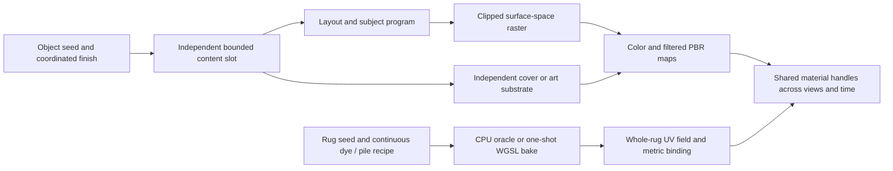

# Screens, whiteboards, rugs and art: procedural expansion

## Objective and limits

Generate useful, repeatable appearance variation for large multi-view reconstruction datasets. A large seed space alone does not prevent memorization: the model can learn a small layout grammar even when every texture hash differs. Qualification therefore separates parameter coverage, low-frequency image similarity, within-room reuse, rendering correctness and cost. No finite material audit establishes transfer to real images or the absence of memorization in a trained model.

Matched diagnostic galleries and measurements remain local under ignored `out/`. The release pipeline creates a separate current-state material atlas; matched study outputs are not inputs to the project page or paper.

## Findings in the existing generator

- Desktop screens select twelve contents inside the same toolbar/sidebar/taskbar. Mobile and TV content are distinct, but share the same palette/content seed and a small number of compositions. Many text rows are solid bars. Only emission and uniform roughness model the display finish.
- Whiteboards select one of ten full-board compositions, with fixed headings and sinusoidal pseudo-writing. Erased marks are global rather than localized. A fresh or nearly blank board is not represented well. Marker content has no independent surface response.
- Rugs have five repeating dye fields, three correlated colors, a pile field and a separate geometric binding. Four per-room texture slots bound residency. Metric UV repetition can make a rug look like a cropped piece of wall-to-wall carpet; bordered or centered designs cannot be aligned with its actual outline.
- Native and WebGPU material baking already share CPU recipe oracles, coupled normal/roughness mips and bounded scratch memory. These contracts must survive the expansion.

## Implementation sequence

### 1. A bounded compositional grammar

Add a shared normalized rectangle subdivision program with independently seeded leaves, continuous split ratios and gaps, area-aware splitting and minimum readable regions. It records the actual regions, not just a template identifier. Keep a strict maximum region count. Layout sampling has a separate random stream from content, palette and surface finish.

For screens, sample application chrome independently: full-screen media, presentation, single application and tiled workspaces. Device roles constrain suitable layouts. Compose charts, documents, tabular data, timelines, diagrams, code and media independently within regions. Vary numerical series, text lengths, vocabulary, hierarchy, alignment, counts, spacing and empty space. Preserve coherent margins and clip all content to its region. Text and imagery are static world-attached textures, shared by every camera and timestep.

For boards, sample blank, sparse and dense use, region count/size, independent diagram/text/math/chart content and local annotations. Use bounded handwriting slant, baseline drift, marker pressure/flow and actual glyph strokes instead of an undifferentiated sine wave. Vary heading presence and wording. Compose old erased content separately with spatially varying wipe marks; retain legible current ink. Do not add coplanar overlay meshes.

### 2. Physical display and board finishes

Sample dielectric roughness, clearcoat and contamination independently of content. Screens span matte anti-glare and polished displays, with bounded white-pixel luminance and truly non-emissive dormant states. Boards remain non-emissive, non-metallic, with local marker/erasure roughness and subtle surface haze. Keep ink in albedo/roughness, not fabricated geometric relief. Bake once, with linear ORM maps, sRGB color maps and complete mip chains. Keep texture dimensions and palette slot budgets bounded.

### 3. Whole-rug textile programs

Add a serializable rug-specific design within the carpet recipe: continuous motif mixtures, scale/spacing, medallion shape, borders, field inset, asymmetric color areas, abrash/dye drift and pile wear. Include quiet/plain rugs as well as richly patterned rugs. Mix stripes, stepped diamonds, organic fields, lattices and center/border compositions rather than multiplying a few family counts.

Use the rug field's normalized, object-local UV domain for the complete design, with the binding still a separate metric textile. Keep relief in metres and the dye/pile fields coupled to roughness. Four shared rug slots remain the residency limit; geometry shape and orientation vary independently. Whole-rug UVs must remain aligned through geometry batching, material selection and diffuse transport. The design is regenerated from the scene material seed; no external texture assets or per-frame synthesis.

Port every new rug field to the one-shot WGSL bake with explicit host/shader layout. Preserve old carpet recipes through optional/defaulted serialized fields. Avoid CPU fallback for the new rugs. Keep floor carpet's existing periodic contract separate from the bounded whole-rug design.

### 4. Audit and visual review

Add a reproducible Rust diagnostic, outside the generation hot path, that exports parameter records, consecutive-seed contact sheets and JSON metrics. Measure exact duplicate counts, downsampled RGB and luminance nearest-neighbor distances, structural fingerprints and parameter marginals. Report dormant/blank populations separately: valid low-information states should not be disguised as failures or silently discarded. Count actual palette-slot reuse rather than claiming every instance is unique. Use the same seed cohort and dimensions for matched cost checks.

### Painting and wall-art extension

Include wall art in the same audit and material assignment contracts. Expand beyond the seven whole-image subjects: sample compositional regions, focal points, subject counts, continuous transforms, layered silhouettes, connected botanical branching, still-life vessels/fruit, architectural perspective, landscapes and abstract/contour marks. Coordinate colors within each artwork while independently sampling the artwork palette, contrast and support. Retain quiet/minimal compositions as valid samples. Distinct objects must not inherit an identical image merely because their furniture/frame finish is coordinated.

Separate paper tooth, woven canvas, paint body and protective varnish. Their roughness and subtle metric relief must not turn dark image content into embossed geometry. Use coupled normal/roughness mip filtering and non-metallic, non-emissive output. Synthetic illustrated subjects remain illustrations, not a claim of asset-free photographic imagery. Review whole framed images, close/grazing finish views and consecutive-seed grids.

Inspect actual PBR renders of the affected surfaces and assembled objects at multiple distances and view angles; raw albedo grids alone do not qualify a material. Check normal/roughness mip behavior, screen emission, board writing, rug outline alignment and semantic/depth/normal invariance. Keep all examples, including low-information ones, in the audit denominator.

### 5. Correctness and performance gates

- Deterministic replay and independent seed streams; no frame/camera dependence.
- Thousands of region samples: finite coordinates, non-overlap, margins and readable minimum extents; raster clipping and bounded work.
- CPU/GPU rug color, normal and ORM parity at every mip, including high-bit seeds and all motif components; actual hardware Chrome WebGPU oracle.
- Finite, dielectric PBR values, zero metalness, opaque alpha, correct mip dimensions and dormant emission.
- Rug outline, height and bounds unchanged; bounded interior tessellation prevents center-fan UV distortion. Shared vertices must have identical UVs, every UV triangle must remain nondegenerate, and the field/binding retain their separate coordinate contracts.
- Matched synthesis/preparation timing and bounded image counts; no caches proportional to total dataset size. Native preparation workers and cooperative browser yielding remain intact.
- Relevant unit tests, strict Clippy and supported WASM library/viewer build. Record unavailable platform or training evaluations explicitly.

## Further qualification, not a promised outcome

After these gates, compare held-out material seeds/compositions and real captures in the downstream reconstruction model. Appearance diversity must not destroy geometric correspondence: the same surface content and lighting remain consistent across views. SigLIP2 distances can complement the recorded low-frequency metrics but neither alone proves useful reconstruction supervision. Large training runs, independent real test sets and controlled ablations are needed to measure memorization and transfer.

## Implemented data flow

Content composition remains a small bounded CPU raster operation. Rug synthesis uses the existing GPU material pipeline by default; diagnostic CPU maps remain its oracle. Surface imagery has no dependency on camera index or frame time. Whole-rug and art relief use reference physical support scales because the bounded material palette can be shared across differently sized objects; they are not exact per-object displacement models.

`examples/audit_display_materials.rs` produces the six-category parameter/duplicate/nearest-neighbor audit. `examples/qualify_materials.rs` accepts a comma-separated category subset and generates production PBR and aligned normal galleries, together with a real-object assignment audit. Neither diagnostic runs during normal scene generation. The local qualification report is `out/display_rug/report.md`; generated artifacts are not publication inputs.
