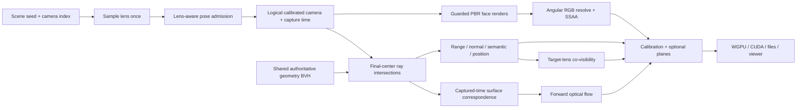

# Calibrated fisheye capture

## Ceiling-mounted CCTV rigs

Set `indoor_camera` to `{"ceiling_mount":{}}`, or enable **Ceiling-mounted
CCTV rig** in Studio's Cameras page. This opts the complete capture rig into
fixed mounts in the primary room. The editor camera and human/furniture motion
remain independent. Disabling the option restores the existing walkthrough
camera and lens settings; the default library behavior is unchanged.

The optical axis is perpendicular to the actual local ceiling and points inward.
Sloping roofs use their analytic surface normal; flat soffits use a downward
normal. A sampled in-plane rotation avoids aligning every image with the room.
The optical center sits 0.12–0.24 m below the surface, with a 0.055 m body radius.
Mounts avoid fixtures and their suspension, ducts, structural members, furniture,
people and available motion reservations. Subsequent object-motion planning
reserves the mounting body as well as the optical center. No visible camera body
is added to the room.

The mounting policy has its own calibrated lens priors:

```json
{
  "baseline": 0.5,
  "ceiling_mount": {
    "standoff_m": [0.12, 0.24],
    "body_radius_m": 0.055,
    "wall_clearance_m": 0.35,
    "lenses": {
      "probability": 1.0,
      "fov_degrees": [170.0, 200.0],
      "circular_probability": 0.75,
      "anisotropy": [1.0, 1.0]
    },
    "intrinsics": {
      "fov_y_min_degrees": 100.0,
      "fov_y_max_degrees": 135.0,
      "bias": 0.0
    }
  }
}
```

`lenses.probability` mixes fisheye and wide rectilinear cameras **within the
mounted rig**. It does not mix mounting roles. The rectilinear prior applies only
to the non-fisheye fraction. Both priors retain their continuous bias/spread
controls. A 180° diameter fisheye sees a hemisphere, including every azimuth
around a downward optical axis; this is the ceiling overview commonly marketed
as a 360° panoramic camera ([Axis panoramic camera documentation](https://whitepapers.axis.com/en-us/panoramic-cameras)).

Lens assignments, standoff and roll are seeded before placement retries.
Baseline, group spread and the configured directed-overlap graph/strata remain
admission constraints. Incompatible combinations (for example near-total overlap
between substantially different footprints) can reject a rig; the planner does
not change its lenses or quietly substitute walkthrough poses. Sampling is
bounded, and a failed `resample_cameras` restores the previous camera set.

Each `IndoorCamera` archives `ceiling_mount` with its surface contact, inward
normal, rotation, standoff and body radius in room-local coordinates. Existing
view exports retain world-space extrinsics (including world-yaw augmentation),
full calibration, ray validity and the correct radial/axial depth convention.
The exact same static pose drives RGB, geometry labels, flow and co-visibility.
Use `camera_curve_clear` for mounting-aware clearance validation;
`camera_clear(position)` remains the walkthrough proposal predicate.

Native and WebGPU use the same CPU mounting planner and existing calibrated
fisheye renderer. Qualification commands:

```sh
cargo test --lib scene::procedural_indoor::cameras::ceiling -- --nocapture
cargo run --example validate_fisheye -- --ceiling --rooms=4 --size=256 --steps=2 --output=out/ceiling-capture
```

## Lens configuration

Fisheye capture is opt-in for library, dataset CLI and Burn consumers: an omitted
`lenses` program remains pinhole. Interactive native/WebGPU Studio starts with a
50% per-camera fisheye preset unless an explicit camera policy is supplied.
Configure the indoor camera program, for example:

```json
{
  "baseline": 0.5,
  "lenses": {
    "probability": 0.5,
    "fov_degrees": [140.0, 210.0],
    "fov_bias": 0.0,
    "fov_spread": 1.0,
    "circular_probability": 0.2,
    "elliptical_probability": 0.0,
    "distortion_strength": 1.0,
    "anisotropy": [0.97, 1.03]
  }
}
```

Pass this JSON through `--indoor-camera`, `BevyZeroverseConfig::indoor_camera`,
or the corresponding Burn generator/capture configuration. Native and WebGPU
Studio controls expose the same settings under Cameras, including independent
perspective and fisheye distribution previews. Slider edits keep keyboard/pointer
focus and scroll position; regenerate explicitly to apply the new sample.
Share URLs omit browser defaults and unchanged nested policy fields, retaining
the active seed, view state and any unapplied edits separately. An explicit
`indoor_camera={}` selects pinhole in the browser; `{"lenses":{}}` selects the
default 50% prior. Historical URLs with full policies remain accepted.

`probability` is a Bernoulli probability for **each camera**, not a rounded
percentage of the cameras in a small rig. It is sampled by scene seed and camera
index before visibility admission, independently of geometry and placement RNGs.
Retries preserve the selected model. Increasing camera count preserves existing
assignments. Missing `lenses` and probability zero leave every camera pinhole.
Intrinsics stay fixed through the capture timeline; existing camera-motion and
baseline controls still govern the poses.

The two FOV bounds describe the fitted angular **diameter**, not a perspective
vertical FOV. `fov_bias` ranges from -1 (narrow) to +1 (wide); `fov_spread`
ranges from 0 (fixed median) to 1 (full spread). Defaults of 0 and 1 preserve
uniform angular sampling, including its original seeded random draws. The
bounded logit distribution is evaluated in angular space so it remains valid
above 180 degrees; it does not use a perspective tangent across its singularity.
Its proposal median is `lo + (0.5 + 0.49*bias)*(hi-lo)`. Visibility admission
can change the realized population, so audit accepted calibrations separately.
Sensor coverage is independent of the radial projection law:

- **Circular** fits a complete disk inside the image, around the realized
  principal point. It has equal focal axes; the sampler records anisotropy 1.
  Custom circular sensors with unequal focal axes are rejected.
- **Diagonal / full-frame** covers every image corner, including shifted optical
  centers and sampled unequal focal axes. `full_frame` is a JSON alias for
  `diagonal`. The fitted diameter spans the farthest normalized sensor corner.
- **Elliptical** explicitly fits a complete ellipse inside the image. Its axis
  ratio follows the sampled anisotropy. Circular and elliptical probabilities
  are absolute masses among fisheye cameras and must sum to at most one; the
  remaining probability selects diagonal/full-frame coverage.

Principal-point jitter shrinks a contained circle/ellipse to the nearest edge;
it does not silently clip it. Pixels outside the lens domain are invalid, rather
than background geometry. These names follow the photographic distinction
between [circular and full-frame fisheye lenses](https://imaging.nikon.com/imaging/information/story/0053/index.html).

## Public abstraction

`bevy_zeroverse_capture::calibration` owns the renderer-independent contract:
`CameraCalibration`, `LensModel`, `Fisheye`, `FisheyeSensor` and `FisheyeFit`.
The root crate reexports these through `calibration` and `camera::lens`.
`project`, `unproject`, `ray`, `in_image` and `depth` use the same model that
generates annotations. Custom calibrated cameras can set
`ZeroverseCamera::fisheye`; procedural scenes archive the realized sensor on
each `IndoorCamera`.

`FisheyeCameraPlugin` is the Bevy integration installed by
`ZeroverseCameraPlugin`. It keeps auxiliary face cameras separate from logical
camera indices and dataset views. The geometry-ray implementation is owned by
the existing ground-truth renderer. Keeping the lightweight contract in the
capture crate avoids adding Bevy/WGPU dependencies to dataset readers, or a
second copy of the lens model in another plugin crate.

## Calibration and numeric targets

The central angular model is

\[
r(\theta)=\theta(1+k_1\theta^2+k_2\theta^4+k_3\theta^6+k_4\theta^8),
\quad \theta=\operatorname{atan2}(\sqrt{x^2+y^2},-z).
\]

K is row-major in pixel units, including skew and optical center. Image axes are
right/down; the top-left pixel center is `(0.5,0.5)`. View axes remain Bevy's
right/up/negative-Z. The coefficient units are radians. Calibration validation
certifies a positive polynomial derivative over the complete angular domain,
using interval bounds, rather than accepting a polynomial from point samples.
The bounded inverse handles rearward rays; it does not use a pinhole matrix or
silently clamp the inverse at 90 degrees.

The coefficient order and angular polynomial match the
[OpenCV fisheye model](https://docs.opencv.org/4.13.0/db/d58/group__calib3d__fisheye.html),
also commonly called a four-coefficient Kannala–Brandt model. All-zero
coefficients give an equidistant lens. This is not the Brown–Conrady radial/tangential
distortion model. For OpenCV interoperability:

- Keep `fx`, `fy` and `D=[k1,k2,k3,k4]`; subtract **0.5** from `cx,cy` when using
  OpenCV's integer-centered pixels. Its skew parameter is `alpha=K[0][1]/fx`.
- Convert Bevy camera coordinates `(x,y,z)` to `(x,-y,-z)` for OpenCV's
  right/down/forward axes. Apply that basis change to extrinsics too.
- Keep the explicit angular-domain mask and range-depth convention. A K/D pair
  alone does not encode image-circle validity or the capture's clip range.
- Forward-hemisphere projection is checked against OpenCV's equations. Our
  `atan2` extension supports rearward rays; OpenCV routines based on `atan(r)`
  must not be assumed to preserve rays beyond 90 degrees from the optical axis.

| Output | Contract |
|---|---|
| RGB | Tone-mapped linear RGBA; existing optional sRGB GPU/CPU conversion applies once. SSAA resolves RGB in linear light. |
| Fisheye depth | Positive Euclidean **ray range** in metres; zero marks no valid first surface. |
| Pinhole depth | Existing positive axial `-view.z` convention. |
| Position | The same first surface, encoded with the existing scene-AABB normalization. Exterior geometry may lie outside `[0,1]`. |
| Normal | Existing encoded unit view-space normal of that surface. |
| Semantic | Existing integer semantic ID internally and deterministic palette on export; never interpolate classes. |
| Optical flow | Source-grid forward displacement in final-image pixels, with correspondence/visibility masks; both endpoints use their captured lens models. |
| Co-visibility | Existing additive camera bitmask, excluding self. Only logical cameras have bits; face count does not consume them. |
| Human poses | Lens-aware joint projection and model-depth frustum test; the explicitly named axial-depth joint field remains axial. |

Pinhole-only archives retain calibration schema 1. A fisheye view carries schema
2 and lens model `angular_fisheye4`, version 1, with its coefficients and maximum
polar angle. Mixed-lens tensor archives use calibration contract 2, per-view
`lens_model` U8 (`0=pinhole`, `1=angular_fisheye4`) and `lens_parameters` F32
`[k1,k2,k3,k4,max_angle_radians]`, alongside K, dimensions, pose and timing.
Pinhole entries have zero angular parameters. Readers must inspect the model;
the legacy `fovy` tensor alone cannot describe a fisheye. Model and range
semantics accompany direct WGPU/CUDA captures in the CPU metadata as well.

The lens-domain mask can be reproduced from calibration independently of scene
visibility. A valid ray with no surface is distinct from an invalid lens pixel.
Geometric annotations retain final-pixel-center samples under SSAA; categorical
IDs, depth, flow and visibility are never averaged across silhouettes. RGB
coverage may be fractional at the lens boundary under SSAA; geometric validity
still describes the final pixel center.

## Rendering and cost

RGB uses co-located perspective faces with overlapping guard bands, followed by
a GPU angular resolve. The supported angular domain needs at most five faces;
narrow lenses contained within the front face use one. Conservative interval
bounds omit side faces that cannot contribute to the actual calibrated sensor,
and crop the remaining faces while preserving the original source texel lattice,
postprocess context and directional-shadow coverage. Adaptive interval refinement
tightens peripheral bounds without evaluating a dense fine grid: cells already
inside the accumulated rectangle cannot extend it. No point-sampled visibility
heuristic, reduced source density or smaller shadow frustum is used. For example, a centered
140-degree diagonal lens on a 16:9 sensor needs three source views; a circular
lens with the same angular diameter still needs five. Face texel density
accounts for the angular mapping and SSAA. Face views share scene assets,
lighting, exposure and time. They follow the logical camera's activity gate,
including idle/readback intervals.

Optional per-view shading settings, render layers and their removals propagate
to every face. A native direct-draw camera keeps that policy on its auxiliary
views. Multi-face renders add a bounded guard band for screen-space context and
blend matching world rays only within that overlap, including three-face
corners. Interior pixels sample one face. This removes hard selection boundaries
without blending geometric or categorical annotations. Bloom, SSAO and finite
shadow maps remain approximations; the compositor does not make them a globally
path-traced lighting solution.

Metric annotations trace final camera rays against the authoritative annotation
triangles, including moving/skinned geometry and the selected glass policy.
A deterministic BVH is shared by all nonlinear views and retained while
geometry/transforms are unchanged. Fixed-bin surface-area splits isolate large
walls/floors from small props; bounded median fallback protects traversal depth.
Large native builds run vertex transforms, triangle expansion, bounds generation,
subtree construction and final triangle ordering on Bevy's existing compute pool.
Linear passes initialize disjoint output slices once in their original order,
using at most eight jobs, including cooperative execution for small or saturated
thread budgets. Checked completion prevents observing partially initialized data.
Surface-area binning scans bounds once for all three axes, preserving split costs
and deterministic ties while reducing repeated memory traffic. Compact partition
records carry their comparison keys, avoiding random bounds reads during median
selection; full triangle payloads remain immutable until the final ordered copy.
Wasm retains serial construction. Certified empty skin updates retain the tree.
All-fisheye rigs avoid uploading unused pinhole geometry/flow buffers; mixed rigs
prepare both paths. Independent annotation preparation can run concurrently.
All capture completion and exact-geometry checks remain in force.
Temporal flow traces the preceding capture's surface and carries its barycentric
correspondence forward. Render frame frequency does not select the endpoints.

Native headless capture checks scene assets and pipelines both before drawing
and before accepting that draw. A late pipeline compilation cannot qualify a
skipped pass. An extraction-time submission check suppresses already-copied
views, including their fisheye sources, when pipelined rendering finishes after
the main-world camera activity check. The next capture epoch restores normal
extraction. Unsupported temporal shading retains conservative settling.

Co-visibility projects each source surface into the target camera's actual
angular domain, then applies the existing first-surface/tangent-plane occlusion
test. This retains the existing nearest-target-pixel tangent-plane policy:
finite sampling can create small holes around thin surfaces and silhouettes. It
is not continuous visibility at unlimited image resolution. Circular masks,
offsets, rearward rays and mixed pinhole/fisheye rigs are included in qualification. Placement overlap remains an approximate
geometry-proxy measurement; it is not a substitute for rendered overlap.

Fisheye rendering costs more than a single perspective render. It is not a
zero-cost postprocessing warp. The disabled path allocates no face textures,
angular BVH or temporal correspondence buffers. Qualification records resolution,
SSAA, camera count, number of frames, geometry/annotation modes and GPU contention
alongside timings; isolated and concurrent-training rates must not be conflated.

RGB source resolution uses a conservative bound on the complete angular-to-face
Jacobian over directions that can reach the sensor. Side views crop directions
outside the lens cone while retaining screen-space filtering context. Their
off-center raster projections preserve the uncropped shadow-cascade frustum;
cropping does not narrow the calibrated lens or disable shadows. Source images
retain Bevy's existing RGBA16Float HDR values, with manual bilinear sampling and
an RGBA32Float final output. Numeric annotations retain their float32 precision.

Angular annotation previews keep the logical view for extraction and exact ray
intersections, skip its unused Core3d passes, and disable the auxiliary RGB
views. Returning to color restores the original render schedule. Hidden camera
grids also stop preview requests and resolve uploads. Trajectory updates reuse
the source allocations and projection bounds.

Interactive grid RGB sources follow the physical tile size, including display
scale and the configured SSAA policy. This avoids rendering full-window-density
cube faces for small thumbnails. The calibrated output dimensions, lens,
projection bounds and shadow-cascade coverage remain fixed. Enabling sampling or
attaching an image copier restores full source density before camera extraction;
headless capture never uses thumbnail density. Numeric annotations are unchanged.

The browser release profile optimizes for execution speed: size-only optimization
is particularly expensive in the render/ECS loops repeated for each fisheye face.
WebGPU reuses bounded light-cluster buffers with the same CPU light assignment and
packing as capture. This avoids allocating and mapping two buffers per active
source view on every frame without changing lighting or shadow quality.
Ordinary WebGPU mesh draws also bind Bevy's existing mesh groups without querying
all device limits for each draw. Skinning, morph targets and lightmaps use Bevy's
original command. Draw IDs, shaders, geometry and shadow passes are preserved;
this optimization requires no patched dependencies.

Interactive fisheye grids batch compatible opaque shadow casters within each
rigid procedural object. The batches copy the original positions, normals and
indices exactly and keep the same parent transform. RGB still uses the original
meshes and materials. Transparent, skinned and articulated parts remain separate.
Batches use a private render layer; a conflicting application layer disables the
optimization. Mesh edits and visibility changes rebuild the affected batch set,
and memory is bounded by vertex and index budgets. Capture or annotation mode
restores the original casters; batch meshes never enter exported geometry.

The preview also budgets CPU light-cluster cells across the logical camera count
(1,024 for one camera, down to 256 for four or more). These are conservative
culling cells, not fewer lights or lower-quality shading. Light order, shadow
resolution and PBR shaders stay unchanged. Custom cluster policies, capture and
scenes with more than 64 clustered lights/probes/decals retain their original
configuration. The policy is tested against float RGB attachments, with a
shadow-off control to detect stale or ineffective validation captures.

For Chrome grid presentation measurements, serve a built `www` directory and run:

```sh
node scripts/bench_camera_grid.mjs \
  '--url=http://127.0.0.1:8000/?scene_type=procedural-indoor&indoor_seed=400&indoor_human_density=0&num_cameras=4&camera_grid=true&camera.lenses.probability=1&width=1280&height=720&gizmos=false&regenerate_ms=0' \
  --wasm=www/out/viewer_bg.wasm --output=out/grid-fisheye.json
```

Repeat with lens probability `0` for the perspective control. This keeps the room
seed but may change lens-aware pose admission; it is not an identical-pose test.
The harness requires a hardware WebGPU adapter, warms pipelines, measures an
eight-second presentation interval, records pass/draw/allocation counts and saves
a screenshot. Use `--dpr=2` to check HiDPI, `--profile` for a CPU profile, and
`playback_mode=Still` for visual comparisons. `--exercise-layout` additionally
resizes the grid and verifies that rendering continues without WebGPU errors.
Keep one viewer active at a time.
Use `--timing-only` to omit per-draw instrumentation from a timing confirmation.
Record concurrent workloads; these numbers do not measure capture throughput.

For a bounded continuous-view workload (distinct from whole-room generation):

```sh
cargo run --example bench_lens_preview -- --frames=40 --pinhole --output=out/lens-pinhole
cargo run --example bench_lens_preview -- --frames=40 --captures --output=out/lens-fisheye
cargo run --example bench_lens_preview -- --frames=10 --all-modes --captures --output=out/lens-modes
```

The control uses the same scene and admitted trajectories, changing only the
projection. The report records static/moving views, frame distributions,
diagnostics, source texture sizes, configuration and engine provenance. Timed
frames exclude readback; optional inspection captures are taken afterward.
Times synchronize the device and include diagnostic instrumentation, so they
are not window presentation FPS. Record concurrent GPU workloads separately.

## Pipeline



## Reproducible qualification

```sh
cargo run --example validate_fisheye -- --cpu
cargo run --example validate_fisheye -- --fixture
cargo run --example validate_fisheye -- --fixture --narrow
cargo run --example validate_fisheye -- --lighting-fixture
cargo run --example validate_fisheye
cargo run --example validate_fisheye -- --bench
```

The first command validates portable shaders and seeded room-camera sampling.
The analytic fixture checks metric intersections, mixed-lens co-visibility and
camera-motion flow independently of the scene generator. The room run checks
capture completion and reprojection and saves actual RGB captures/calibration.
The benchmark uses the same full-quality generation path at three 512×512 views.
For a matched pinhole control, add `--pinhole --matched`: both runs then admit the
same lens-aware trajectories, and only the capture projection is changed. The
publication crate's `fisheye-performance` command rejects different scene
manifests, poses, quality settings or capture-engine identities. Lighting tests
compare identical world rays across face boundaries and execute the production
compositor on the rendered textures to check final-image continuity.
Results and platform qualification are recorded with the generated evidence;
successful compilation alone is not rendered or cross-platform qualification.

## Qualification status

The source-bound receipt in `docs/evidence/fisheye` binds every gallery image and
paper result to the captured generator. The current native cohort contains six
consecutive furnished rooms (400–405), three 512×512 views and two timestamps.
RGB, depth, normal, position, semantic, flow and co-visibility captures pass the
pixelwise geometric checks. The twelve-camera smoke case also passes.

Independent moving-occluder fixtures exercise wide and single-face narrow lenses,
including mixed pinhole/fisheye rigs. The wide fixture has zero co-visibility
mismatches across 48,625 relations, maximum position error 0.153 mm, maximum flow
error 0.001818 pixels, and zero RGB core-mask mismatches. These checks exclude
silhouette discontinuities where finite visibility sampling is ambiguous.

Matched native measurements on RTX PRO 6000 Blackwell, NVIDIA 610.43.02, Vulkan:

| Workload | Pinhole rooms/s | Fisheye rooms/s | Relative throughput |
|---|---:|---:|---:|
| RGB, one timestamp | 0.979 | 0.834 | 85.2% |
| RGB plus six annotations, two timestamps | 0.815 | 0.517 | 63.5% |

Each case uses the same six rooms and camera poses, with the first room reported
separately and the remaining five timed. Automatic 2× SSAA, 2048 shadow maps,
GPU materials and 256-ray GI stay enabled. Times include scene generation,
rendering and CPU readback; startup and report-image writing are excluded.
Training was paused. These small cohorts do not establish steady-state or
concurrent-training throughput, and are not direct Burn/CUDA transport timings.
All cameras in these cases are fisheye; the optional mixed prior is a different
workload. Wide angular coverage still costs more than one perspective view.

The native lighting fixture retains fixed exposure, reflection, glass,
emissive surfaces, bloom and shadow-enabled directional/point/spot cases;
the combined case also includes SSAO. All 6,180 production-compositor boundary
approaches pass, with maximum linear-RGB jump 0.000301. The raw pre-composite
right/top directional-light diagnostic still has mean error 0.025294, above
its 0.025 limit. This failed diagnostic is retained: smooth blending does not
establish globally identical radiance or path-traced lighting accuracy.

CPU tests cover canonical sensor fits, shifted centers, aspects, an independent
OpenCV forward-hemisphere oracle, inverse projection and invalid parameters.
The 1,024-seed × 12-slot audit yields 3,062 angular cameras and 625 circular
cameras, with exact replay and valid calibration. BVH equivalence tests preserve
triangle payloads, conservative bounds and leaf membership. Shader validation,
strict workspace Clippy, mixed-lens archives and the WebAssembly human-motion
build pass. View-setting propagation covers edits, removals and unchanged frames.

Browser/Metal/M4 runtime parity, long-run stability and direct Burn/CUDA fisheye
consumption remain unqualified for this change. The report and paper distinguish
these limits from the completed native checks.

For downstream models, known-intrinsics rectification remains a useful baseline.
Native fisheye training should condition on calibrated rays (and validity), not
assume straight epipolar lines or a single perspective matrix. The broader
roadmap and rectification tradeoffs are in [the lens roadmap](fisheye_lens_roadmap.md).


Native completed-capture qualification uses an explicit warmup population,
matched room geometry/poses, and full native quality:

```sh
cargo run --example validate_fisheye -- --bench --warmup=4 --rooms=4 --steps=1 --size=512 --cameras=3 --output=out/native-fisheye
cargo run --example validate_fisheye -- --bench --warmup=4 --rooms=4 --steps=1 --size=512 --cameras=3 --pinhole --matched --output=out/native-pinhole
```

Repeat in reversed order alongside the same training workload. Add `--rgb-only`
to isolate color generation. Timings include construction, rendering and completed
CPU readback, excluding PNG encoding and application startup; these are not
Burn consumer or display-FPS measurements. Reports include exact geometry counters,
angular acceleration construction time/upload bytes, application frame counts,
and settling-fence counts. Source views and numeric annotation targets retain
full quality; a lower intermediate resolution is not used to claim capture parity.
The analytic `--fixture` (mixed lenses), `--fixture --all-angular`,
`--fixture --narrow` and `--lighting-fixture` checks cover correspondence,
co-visibility, surface alignment and lighting independently of throughput.
