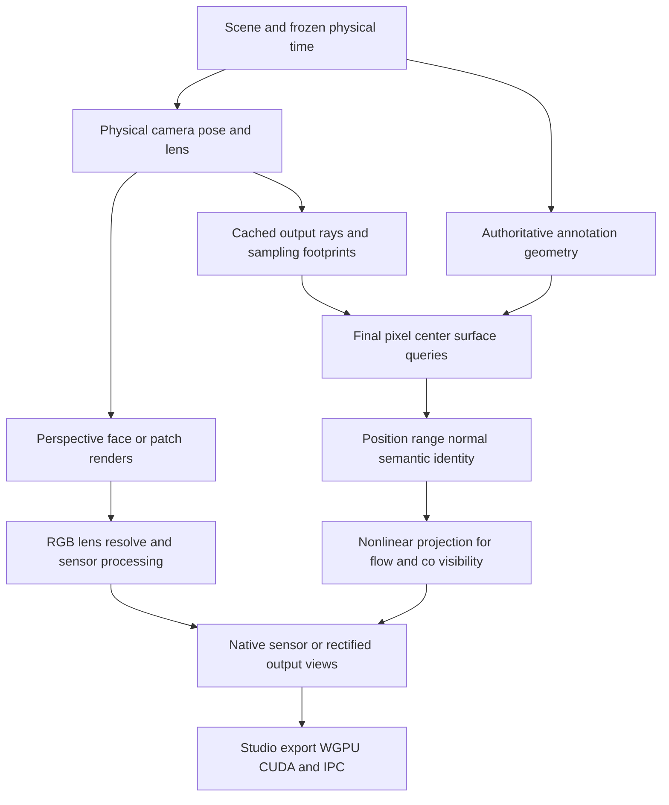

# Fisheye lenses and deployment camera roadmap

Status: the central angular model, native/WebGPU rendering integration, mixed-lens
annotations, sampling, studio controls and versioned exports are implemented. See [the implemented camera contract and qualification](fisheye_cameras.md).
The later phases below remain a design roadmap: calibrated rectification,
additional lens models, optical effects, device-specific qualification and
controlled downstream learning comparisons are not implied by this implementation.

## 1. Recommended direction

For a reconstruction/completion model that currently consumes pinhole images,
start with **calibrated rectification at deployment and deployment-matched
rectified training data**. Known calibration removes much of the reason to ask
the model to discover lens geometry. It does not remove the cost of resampling,
lost peripheral coverage, calibration residuals or a mismatch between pristine
synthetic pinhole images and rectified real images.

Build Zeroverse's camera abstraction around **pixels and calibrated rays**, so
native fisheye is a supported next step rather than a separate generator. Keep
the existing pinhole renderer and export behavior intact. First qualify the
camera/annotation contract; then compare rectified and native-fisheye models on
the actual devices before changing the production training distribution.

The likely best near-term product is a shared generator with three explicit
output choices:

1. Direct pinhole images for existing consumers.
2. Rectified views derived from a simulated or imported calibrated sensor,
   including its finite resolution and resampling footprint.
3. Native distorted sensor images, with the lens model, masks and optional ray
   tensors required by a camera-aware consumer.

Supporting native fisheye in the generator does not require every training run
to consume fisheye. Conversely, good rectified training benefits from simulating
the sensor that produced the rectified image.

## 2. Implemented camera boundary

| Area | Implemented behavior | Remaining extension |
| --- | --- | --- |
| Camera math | Renderer-independent pinhole and angular-polynomial calibration, full K, half-pixel centers, monotonic inverse and domain masks | Additional measured lens families and rectification |
| RGB projection | `camera::lens::FisheyeCameraPlugin`: guarded perspective faces and GPU resolve; auxiliary faces are not dataset views | Broader cross-vendor seam and screen-space-effect qualification |
| Intrinsic sampling | Independent scene/index lens assignment with continuous FOV, distortion, anisotropy and existing principal-point sampling | Imported device calibration distributions |
| Admission | Lens-aware coverage rays and existing room/trajectory safety constraints | Deployment-specific overlap distribution fitting |
| Numeric geometry | Final-center rays intersect authoritative triangles in a shared BVH; angular depth is ray range | Near/far clipping parity at extreme boundaries |
| Visibility and flow | Actual source/target lens models, target validity and first-surface occlusion; captured time endpoints | Larger moving/skinned and device matrices |
| SSAA | Linear-light RGB filtering; unaveraged categorical and metric targets | Measured angular reconstruction filter alternatives |
| GPU consumers | Per-view model/depth metadata, existing WGPU/CUDA transport and color conversion | Lens-specific downstream CUDA consumer qualification |
| File and Python readers | Versioned heterogeneous lens IDs/parameters; old pinhole-only archives retain schema 1 | Runtime validation across more consumer environments |
| Poses and schematics | Lens-aware joint projection and sampled angular footprints | Non-central cameras |
| Studio and URLs | Shared native/web lens frequency and shape controls, explicit regeneration and serialized camera program | Imported-calibration editor and derived rectified views |

Bevy 0.20's `CameraProjection` interface still produces a matrix and eight
frustum corners. A custom implementation returning a different matrix cannot
represent a general fisheye. Changing only projected mesh vertices is also
insufficient: straight triangle edges become curves under nonlinear projection,
while ordinary rasterization still connects vertices with straight lines.

A limited downstream inspection found that the Gekko schematic prediction path
in `crates/burn_gekko_capture/src/schematic/pose.rs` describes focal-only intrinsic
predictions, without principal point or distortion. That is an integration
warning, not an audit of every downstream model head. Raw fisheye should not be
introduced into that contract without checking the training targets, losses,
reprojection helpers and evaluation code together.

## 3. Rectified versus native fisheye training

| Choice | Benefits | Costs and limitations | Best use |
| --- | --- | --- | --- |
| One rectified pinhole per sensor | Compatible with existing models, losses and geometric libraries; familiar image statistics; compact model input | Crops coverage or stretches edges; interpolation changes texture statistics; one plane cannot retain a hemisphere; sensitive to the calibration used for rectification | Initial deployment when a useful central field covers the task |
| Several rectified virtual views per sensor | Preserves more peripheral coverage with moderate per-view distortion; reuses pinhole components | More tokens/inference work, duplicate rays, tile boundaries, correlated sensor noise and more complicated fusion | Wide coverage is needed but model changes should be small |
| Native fisheye with calibrated rays | Retains sensor sampling and peripheral context; avoids mandatory rectification; supports heterogeneous central-camera rigs | Lens-aware sampling, losses, labels and model conditioning are required; image scale varies spatially; off-the-shelf pinhole assumptions become unsafe | Peripheral information is valuable and the model/runtime can support it |
| Mixed lens training with a common ray contract | Can expose one model to actual camera families and support future devices | More distribution design and evaluation; broad randomization can waste capacity or hurt the existing domain | A longer-term deployment with several materially different devices |

Fisheye projection is not simply a bad pinhole image. For angle θ from the
optical axis, perspective uses `r = f tan(θ)`, while equidistant fisheye uses
`r = f θ`. A finite perspective image cannot cover the full 180° hemisphere.
Other physical fisheyes follow different radial laws; “fisheye” must not mean
one generic barrel filter. See the [Kannala–Brandt camera model](https://users.aalto.fi/~kannalj1/calibration/Kannala_Brandt_calibration.pdf).

For a centered rectilinear horizontal slice, the radial angular magnification at
the edge relative to the image center is `sec²(horizontal_fov / 2)`:

| Horizontal rectified FOV | Edge versus center angular magnification |
| --- | ---: |
| 100° | 2.42× |
| 120° | 4.00× |
| 140° | 8.55× |
| 160° | 33.16× |

These are geometric derivatives, not measured resolution loss or pixel-retention
fractions. They explain why making one enormous rectified image is often less
useful than a moderate crop or several virtual views. A 90–110° horizontal
rectified view is a reasonable initial experiment, not a universal default;
choose the actual crop from task coverage and measured source-pixel footprints.

For model robustness, the important distinctions are:

- **Known lens, unknown relative pose:** use calibration as conditioning and
  estimate pose/completion. No need to make the model relearn known distortion.
- **Imperfect calibration:** distinguish true rendering calibration from the
  noisy calibration supplied to the model; evaluate residual correction.
- **Unknown lens calibration as a task:** do not supply the exact target lens
  or its ray map as input. That would make a calibration score misleading.
- **Arbitrary camera generalization:** condition on rays, evaluate held-out
  devices/lens families, and consider predicting range or XYZ rather than only
  camera-Z. [UniK3D](https://arxiv.org/abs/2503.16591) provides research evidence
  for spherical/ray representations across camera types, but its monocular
  results do not establish a gain for this cross-view training pipeline.

Virtual views from the same central sensor have the same optical center. They
add coverage, not translational parallax. Their overlapping pixels may be the
same underlying measurements; they must not be scored as independent stereo
evidence or allowed to leak masked completion targets through another tile.

## 4. Lens math and camera contract

### 4.1 Models in priority order

1. **Pinhole v1:** retain current arithmetic, sampling defaults and exports.
2. **Brown–Conrady radial/tangential distortion:** cover ordinary imperfect
   wide-angle lenses. Specify coefficient order, forward-versus-inverse mapping
   and normalization; begin with one exact supported convention. Add rational,
   thin-prism or sensor-tilt terms only when actual calibrations require them.
3. **A four-coefficient angular fisheye model:** use
   `g(θ) = θ(1 + k1 θ² + k2 θ⁴ + k3 θ⁶ + k4 θ⁸)`, with pixel scaling through K.
   Zero coefficients mean equidistant fisheye, **not pinhole**. Support OpenCV
   import/export within a tested common domain. Its [fisheye documentation](https://docs.opencv.org/4.x/db/d58/group__calib3d__fisheye.html)
   defines the coefficient and pixel conventions; its [current implementation](https://github.com/opencv/opencv/blob/4.x/modules/calib3d/src/fisheye.cpp)
   explicitly limits part of its inverse path to 180° FOV. Do not label a
   beyond-hemisphere extension “OpenCV equivalent.”
4. **Double Sphere:** add when the device inventory or measured cost justifies
   it; it has a closed-form inverse and an explicitly defined valid domain.
   Match its actual parameters rather than translating four unrelated
   distortion numbers. See [Usenko et al.](https://arxiv.org/abs/1807.08957).
5. **Calibrated custom central ray fields:** later, for residual distortion not
   well fit by the above. A pixel-to-ray LUT alone is insufficient: flow and
   co-visibility also need a validated inverse ray-to-pixel mapping.

Start numeric qualification below a full 180° field, then deliberately test
hemisphere and greater-than-hemisphere coverage. Use `atan2(transverse, forward)`
for a full polar-angle model, not `atan(transverse / forward)` with a lost
quadrant. Beyond-180° support needs its own versioned domain and tests. Do not
claim support for stitched dual-camera panoramas or other noncentral systems
through a single pose and central lens.

### 4.2 Shared operations

The core library should expose model-independent operations for:

```text
validate_calibration(calibration) -> validated camera or typed error
pixel_to_unit_ray(calibration, pixel) -> ray or domain error
point_to_pixel(calibration, camera_point) -> pixel or domain error
contains_sensor_pixel(calibration, pixel) -> bool
projection_jacobian(calibration, camera_point) -> derivatives or error
ray_footprint(calibration, pixel) -> angular sampling estimate
```

Keep them in the lightweight capture/calibration crate so renderers, samplers,
Rust/Python readers and downstream training share the same convention. Maintain
a separate f64 CPU oracle and shared test vectors for f32 CPU/WGSL implementations;
generating matching code does not replace independent numerical tests.

Use Bevy camera coordinates `+X right, +Y up, −Z forward` at the public Rust
boundary and image coordinates `+u right, +v down`. For unit ray d and positive
range ρ, the camera-space point is `p = ρ d`. Axial depth is `z = −p.z`.
For a forward ray, `ρ = z / (−d.z)`. That conversion becomes ill-conditioned as
the ray approaches 90° off-axis; a valid rearward ray has negative axial depth.
Range remains positive. New fisheye outputs must not overload “zero or negative
depth means invalid.”

Near/far semantics must also be explicit. Preserve pinhole axial clipping;
use a declared radial interval for the proposed native fisheye contract. Internal
cube faces have implementation-specific axial planes that must not leak into
final clipping, exported depth or annotation validity.

### 4.3 Proposed schema

Introduce `CameraCalibrationV2`/equivalent as a deliberate migration; do not
silently extend the meaning of the exact v1 JSON string. Suggested components:

| Component | Required information |
| --- | --- |
| Model | Stable family name and model version; named coefficients and order |
| Pixel geometry | Width/height, full K, pixel-center convention, sensor crop/rotation |
| Domain | Valid sensor region, supported angular interval, numerical validity certificate |
| Depth and normals | Range versus axial depth; units, clipping convention and normal coordinate frame |
| Identity | Physical camera ID, logical output-view ID, calibration ID and optional parent-view ID |
| Derived view | Rectification rotation, output K/size/crop, source sensor calibration and mapping version |
| Timing | Physical time, trajectory progress, source/target capture endpoints |
| Sampling | RGB transfer function, SSAA/filter policy, validity-mask meanings and sensor-processing order |

Separate the mathematical projection domain from the valid sensor footprint.
Flow can have a projectable target outside the image, while visibility requires
an in-sensor target. A calibrated circular/elliptical mask or irregular crop
must not be approximated solely by an axis-aligned bounding rectangle.

K remains useful for image scaling and principal point, but **K alone does not
define a nonlinear camera**. Make a perspective matrix available only when it
actually exists. Preserve legacy `fovy` on pinhole views; a v2 consumer should
use lens-derived angular coverage rather than treating a fisheye FOV summary as
a perspective parameter. Do not emit fake focal lengths or identity projections
to satisfy an old reader.

Validate finite parameters, positive scales, image/domain consistency, non-folding
projection, invertibility and bounded inverse residual. For radial polynomial
sampling, certify `g'(θ) > ε` over the admitted interval with a polynomial/root
bound, not just a few sampled pixels. General asymmetric models need an
appropriate injectivity/domain check; a locally positive Jacobian alone does
not prove global uniqueness. Failed calibration must produce an actionable error,
not a silently clamped foldover.

### 4.4 API boundaries

Use a serializable tagged model with named coefficients, a validated runtime
camera and a separate output-view specification. For example, this is the
proposed shape, not code or configuration accepted by the current release:

```text
LensProjection =
    Pinhole
  | BrownConrady5 { radial: [k1,k2,k3], tangential: [p1,p2] }
  | AngularFisheye4 { radial: [k1,k2,k3,k4] }
  | DoubleSphere { xi, alpha }

PhysicalCamera = { id, pose_trajectory, calibration, sensor_pipeline }
OutputView =
    NativeSensor { physical_camera_id }
  | Rectified { physical_camera_id, physical_from_output_rotation,
                output_K, output_size, crop, resampling_policy }

LensSamplingPolicy = { profile_distribution, continuous_parameter_priors,
                       within_rig_correlation, variation_scope }
```

The sample contains realized calibration, not just the sampling policy. Keep
lens policy available to all capture-camera scene types; indoor camera placement
is one consumer. Provide fixed/imported calibration as well as sampling. Reject
ambiguous combinations of explicit K, requested FOV and source crop instead of
guessing which wins. Existing pinhole configurations need no new fields. Expose
logical output choices to callers while keeping face counts, workgroup sizing
and cache scheduling internal to the renderer.

## 5. Rendering design



### 5.1 Preserve the pinhole fast path

With fisheye disabled, allocate no ray LUTs, face targets, lens pipelines or
annotation acceleration structures. Keep the old camera sampler stream and
capture scheduling. A lens-specific render bundle must appear as one logical
capture view to readiness, time advancement, camera grids and output writers.

### 5.2 Preferred portable RGB path

Use ordinary Bevy PBR perspective views at one optical center and a GPU lens
resolve. For mild front-facing distortion, a correctly sized overscan view can
be efficient. For large angular coverage, use the required cube faces or a
small certified perspective-patch cover. A single existing pinhole render cannot
supply rays it never rendered, and near-180° perspective overscan becomes
impractical. Coverage planning must use the entire valid output domain and
filter footprint, not just four image corners.

All internal views must share the exact physical time, scene snapshot, exposure,
lighting, temporal object/human states and camera center. Transform face-local
normals to the physical output camera frame. Keep auxiliary faces out of
capture counts, pose exports, camera legends and sample dimensions.

Derive conservative internal near/far planes from the physical radial interval.
For example, a cube-face ray can have a forward component as small as
`1/sqrt(3)` of its range; copying the physical near distance into every face's
axial near plane can discard valid edge rays. Apply the final declared clipping
test after resolving the physical ray.

The resolve samples the inverse lens mapping. Choose source resolution and
filtering from the mapping Jacobian so edge stretch does not introduce new
moire or blur. Test cube-edge continuity explicitly. Do not blend samples from
different surfaces to conceal an incorrect seam. Define texture LOD/derivatives
and seam-aware filtering, including alpha-tested foliage/hair.

Screen-space AO, transmission/reflections, exposure adaptation and temporal
filters can disagree between faces. Share valid resources where Bevy permits,
use common exposure and qualify seam strips under glass, glossy furniture and
moving actors. Preserve the current quality settings; if an effect cannot be
made coherent, document the unsupported combination rather than disabling it
silently or claiming photographic parity.

### 5.3 Numeric annotations need stronger guarantees

Nearest-neighbor sampling of a cube-map G-buffer does **not** generally hit the
final fisheye pixel-center ray. It can miss thin objects, choose the wrong side
of a silhouette, or produce a world position that fails self-reprojection.
Bilinear interpolation of depth/IDs makes the problem worse.

Preferred design: final-ray triangle intersection for numeric annotations using
portable WGSL compute and a bounded acceleration structure built from the same
geometry snapshot as RGB. Reuse existing BVH construction/intersection code
where suitable, but not the existing GI geometry subset unchanged. That subset
has different material/visibility rules; the exterior closure is explicitly
excluded from GI transport, and moving geometry needs captured-time updates.

The annotation structure must include eligible exterior closure, glass policy,
two-sided/culling rules, alpha tests, semantic/instance ownership, interpolated
geometry normals and exact deformed positions. Reuse the existing ground-truth
extraction/skinning contract. Rigid assemblies can share immutable local meshes
with updated transforms; deforming actors need bounded refit/rebuild and stable
primitive/barycentric correspondence for temporal labels.

Before committing to the implementation, compare this approach with conservative
angular triangle bins or a certified adaptive-raster method. A candidate-ID
buffer sampled at a few raster locations is not a complete visibility oracle.
The selected method must pass final-ray intersection and silhouette tests with
no holes or silently dropped overflow. Hardware ray tracing is not required and
must not become a prerequisite for WebGPU or the default publishable crates.

This is the largest new rendering work package. Treat full nonlinear annotation
support as a prerequisite for advertising training-ready fisheye, even if an
RGB-only development preview arrives earlier.

## 6. Annotation behavior

| Output | Fisheye and rectification requirements |
| --- | --- |
| RGB | Render all supported rays; preserve physical-camera exposure and explicit linear/sRGB conversion; lens masking is not a semantic class |
| Depth | Export positive metric range for native fisheye under a new declared contract; optional axial depth is separately named; retain current pinhole defaults |
| Position | Preserve exact world position and primary-room normalization; outside-primary geometry can remain outside [0,1]; do not clip it to the primary AABB |
| Normal | Interpolate/normalize according to the current geometry-normal contract and express in the declared world or output-camera basis; never retain cube-face axes |
| Semantic and instance | Select the first eligible surface at the final pixel center; integer labels remain categorical; no bilinear blending or invented classes |
| Optical flow | Track the source surface to the target physical time and project through the target lens; compute target pixel minus source pixel in final output pixels |
| Motion vectors | Preserve the relationship to optical flow through final width/height normalization; no engine-FPS dependency in numeric capture |
| Co-visibility | Project source world hits into each target lens, test valid region/clipping and target occlusion; preserve directed masks and deterministic per-view legend |
| Human pose | Keep world joints unchanged; project each through the actual lens; separate projectability, sensor inclusion and occlusion; preserve joint-through-own-body overlay policy |
| 3D boxes | World AABB/OBB identity and metric extents remain unchanged |
| 2D box or overlay | Project curved edges adaptively or derive visible boxes from an instance mask; eight projected OBB corners are insufficient under nonlinear projection; distinguish amodal and visible boxes |
| Schematic | Draw sampled angular coverage/ground intersections and physical versus virtual cameras; preserve geometry footprints and prediction overlay APIs |
| O-voxel | Remains a primary-region world-geometry export with its existing static/single-timestep restrictions; fisheye does not relax them |

Maintain separate masks for `lens_valid`, `surface_valid`, `flow_valid` and
`flow_visible`. A valid ray with no in-range hit is different from an invalid
lens pixel. Padding, black lens borders, sky geometry and an unshared surface
must not become interchangeable zero values. Numeric payloads may keep a finite
zero sentinel only alongside explicit validity.

Fisheye depth previews must use the physical depth convention with one common
palette/range. Internal faces have different hardware depth values; displaying
those values directly would introduce artificial discontinuities. Preserve
legacy pinhole colorization while defining an explicit metric display mapping
for the new lens modes.

Preserve `annotation_glass=surface|through` consistently across all geometric
channels. Through mode follows unrefracted rays past eligible transmitting
surfaces; it is not the optical path of RGB refraction. Fisheye must neither
silently change that policy nor claim geometric labels follow reflected images.

For SSAA, integrate RGB over the final lens-pixel footprint and retain the final
center-ray geometric labels. A mixed RGB boundary pixel can legitimately have a
single center-ray label under this contract. Record lens coverage at partially
masked RGB pixels separately; do not average semantic colors or co-visibility
membership bits. Keep current auto-SSAA behavior for existing pinhole captures.

Flow cannot be obtained by warping a vector image as though its components were
RGB. If a valid point mapping W converts a source image to a derived view, the
derived displacement is `W_target(p + flow(p)) − W_source(p)`, with appropriate
source sampling and validity. Direct surface correspondence and target-lens
projection are the preferred implementation, including cross-face motion and
animated humans/doors/chairs. The final captured timestep retains no-successor
behavior.

Co-visibility should initially retain at most 16 **logical output views**, with
physical-camera IDs included in the legend. Internal render faces never consume
bits. More than 16 derived outputs must fail clearly or use a separately
versioned wider format; never silently wrap bits. Report same-sensor overlap
separately from cross-sensor overlap and exclude it from stereo-baseline metrics.

## 7. Rectification as a first-class derived view

Use inverse mapping from each virtual pinhole pixel to a source-sensor ray and
pixel. Preserve both calibrations and the rectification rotation. If
`R_physical_from_virtual` maps virtual rays into the physical camera frame,
then `world_from_virtual = world_from_physical * R_physical_from_virtual`, with
unchanged optical-center translation. Export that actual virtual pose and K.
Do not reuse physical-camera extrinsics after rotating the virtual view.

OpenCV offers explicit mapping and new-camera-matrix functions for rectification;
its balance and output-size controls affect the resulting K and usable image.
Match their meaning in the adapter, not merely their field names.
[OpenCV rectification API](https://docs.opencv.org/4.x/db/d58/group__calib3d__fisheye.html)

Required operational details:

- Import the active sensor resolution, distortion model, crop/orientation and
  ISP mode. Calibration for a different video crop is not sufficient. A K
  matrix without distortion coefficients/model is not full fisheye calibration.
- Convert pixel conventions explicitly. An integer-center calibration imported
  into Zeroverse's half-center convention shifts principal point by +0.5 pixels;
  export reverses it. Resize/crop tests must include this conversion. In the
  half-center edge-coordinate convention, a crop `(x0,y0)` and scale `(sx,sy)`
  give `cx' = sx(cx−x0)`, `cy' = sy(cy−y0)`, with row-scaled K.
- Export the actual output K, dimensions, source ROI, valid mask, rotation,
  filter and mapping hash. A requested “100° view” is not sufficient metadata.
- Simulate finite source sampling, spatially varying blur/noise, vignetting and
  quantization/ISP effects in their declared order. Draw sensor noise once per
  physical image so overlapping virtual views remain correlated. Do not add
  independent noise to each tile and call it the same sensor capture.
- Resolve annotations from final virtual center rays, or validate any alternate
  resampling against those rays. RGB resampling does not authorize averaging
  metric surfaces or categorical annotations.
- Keep all virtual tiles from a sensor/scene/timestep in one family/split. For
  masked completion, mask corresponding physical rays across overlapping tiles
  before feature encoding, or prohibit same-sensor source/target leakage pairs.
- Keep original distorted images optionally for audits. Production need not
  copy or save them when only rectified training tensors were requested.

A direct pinhole render can be an exact geometric oracle for a rectified view,
but it does not reproduce the source fisheye's finite sampling and sensor
history. A ray-footprint-aware fused approximation may later avoid intermediate
images; it must be compared with the explicit raw-then-rectified reference.

## 8. Sampling cameras and lenses

Extend the existing continuous lens sampler, not the baseline slider. Baseline
continues to mean spatial camera separation/coverage preference; projection
family and angular sampling are independent controls.

Use a hierarchy with a seedable device/rig profile, per-camera calibration and
optional per-sequence variation. Default physical lens parameters stay fixed
through time, including when the camera moves. Identical sensors on a rig can
share a family with correlated manufacturing variations; mixed rigs can opt
into different lenses. Per-frame random distortion is not a realistic substitute
for device diversity. Zoom/focus breathing, stabilization and rolling shutter
require separate temporal models and are deferred unless the device inventory
demonstrates a need.

The proposal should sample:

- Angular coverage and center angular resolution, aspect ratio and valid sensor
  footprint; distinguish horizontal, vertical, diagonal and circular coverage.
- Focal scales, principal point, mild skew/asymmetry when appropriate, and
  correlated distortion around measured or physically constrained lens families.
- Rectification FOV, orientation, crop and tile overlap when derived views are
  requested. These are sampled jointly with the task's required coverage.
- A distribution of optical quality conditional on lens and image radius, kept
  distinct from geometric calibration and from geometry/semantic labels.

Retain bias/spread UX for continuous parameters. Expose family mixture weights
only for genuine model/device families, not arbitrary FOV bands. Do not sample
independent large polynomial coefficients: most of that box can be unrealistic
or non-invertible. Sample meaningful shapes or calibrated distributions and
validate the resulting lens. A proposal-density display must be accompanied by
realized histograms and rejection reasons.

Sample lens parameters before evaluating placement/overlap. Replace pinhole
projections in coverage, visibility, near-clearance, motion planning and recovery
with the shared lens operations. Separate physical camera-body clearance from
render-ray clipping: a fisheye's near domain is not an enormous perspective
near-plane rectangle. Continue swept tests over full trajectories and actual
room floors, walls, furniture and moving obstacles.

Measure camera counts 1–12 and baseline 0/0.5/1, including native/native,
rectified/rectified and mixed-lens pairs. Fisheyes often see more shared pixels,
but extra overlap alone does not establish useful triangulation. Record:

- Metric baseline and distribution of triangulation angles on shared surfaces.
- Directed rendered overlap, separately from approximate placement overlap.
- Pixel-weighted, solid-angle-weighted and primary-room-only overlap.
- Radial bands of shared coverage, surface-hit rate, periphery-only coverage,
  camera/trajectory near-duplicates and connected graph components.
- Physical camera count, logical view count, unique source rays and independent
  baseline-bearing pairs. Lens warps of one scene are not new scene geometries.
- Accepted lens distribution and rejection rates by room family, count, baseline
  and lens domain. Never drop hard samples after model inference to improve a
  reported overlap or learning result.

Domain-separate lens RNG from geometry/material/human streams. A matched study
must keep the same room, motion and physical poses when comparing lenses,
unless it explicitly studies lens-conditioned placement. Record both experiment
types; they answer different questions.

For a central unit-ray field d(u,v), the solid-angle weight is the pixel
integral of `|∂d/∂u × ∂d/∂v|`. Use that weight for angular diagnostics alongside
ordinary pixel counts; neither statistic is automatically unique world surface
area. At equal pixel count, a wider field can trade object detail for coverage,
so record small-object/pixel footprints and useful shared-surface detail too.

## 9. Studio, web viewer and published examples

Use one typed configuration and shared native/WebGPU controls:

| UI surface | Proposed behavior |
| --- | --- |
| Capture lens panel | Physical model/profile, angular coverage, valid image shape, continuous variation and import/export calibration |
| Output panel | Native sensor, one rectified view or virtual view set; show output coverage, retained sensor area and estimated work |
| Camera grid | Stable logical view IDs with physical parent labels; same scene/time across annotations; auxiliary faces hidden |
| Editor camera | Keep normal navigation and persistent editor intrinsics; explicitly enter a capture-lens preview when requested |
| Picking | Convert displayed pixel through its lens to a world ray; handle masked image areas without false selections |
| Gizmos | Sample lens boundary/central rays instead of drawing a fake four-sided pinhole pyramid |
| Room schematic | Show bounded angular footprints and actual floor intersections, with physical and virtual poses distinguishable; support predicted lenses/poses |
| Annotation display | Range/axial names, domain/surface masks, consistent depth palette and exact geometry overlays; numeric and approximate velocity previews visibly distinguished |
| URL/state | Serialize model versions, coefficients/profile, output transform and seed; update only through existing Apply/Next behavior; no slider-triggered regeneration |
| Capability errors | Explain unsupported model/domain/device/annotation combinations before allocation; do not silently render a pinhole fallback |

A curved lens boundary can have extrema between the four image corners; floor
coverage can be disconnected or absent for upward rays. Use sampled curves or
well-defined ray intersections rather than a misleading convex hull. Document
whether a schematic footprint is an angular range envelope or actual visible
floor geometry. Apply the same interpretation to predicted-camera overlays.

Keep paper/project galleries within the existing formal publication generator.
One matched scene/view selector should offer lens mode, rectification and all
qualified annotations. Add angular-coverage and periphery-error plots, camera
count/baseline distributions and a throughput table tied to capture receipts.
Publish only implemented/qualified behavior, with exact source provenance;
do not turn the front page into a roadmap or version-to-version delta report.
Keep new qualification captures local until publication is explicitly requested.

## 10. Export and downstream GPU APIs

### 10.1 Storage and metadata

Version Rust `View` metadata, filesystem/NPZ, safetensors, FFI/Python, GPU sample
metadata and IPC descriptors together. Maintain a clean v1 pinhole reader/writer
path. Old consumers must reject v2 unsupported lenses rather than interpret
them as pinhole. New readers must preserve legacy archives without inventing
missing calibration.

Version the C/Python FFI layout or use an explicitly sized extension descriptor;
adding fields to an assumed fixed-size struct must not cause old consumers to
read past their allocation. Include old-library/new-reader and
new-library/old-reader failure-path tests.

For dense batches, keep K `[... ,3,3]` and image dimensions, and add typed model
IDs/versions plus coefficient count/validity and a documented parameter layout.
Use a calibration table with per-view indices when metadata is shared across
timesteps. Mixed lenses cannot be represented by one global `lens_model=pinhole`
string. Padding must not turn absent coefficients into a different camera.
Initially require a shared image size within a dense batch; support ragged
outputs only through an explicit padded-mask or grouping contract.

Optional tensors include camera-local unit rays `[... ,H,W,3]`, valid-domain
masks and angular-footprint measures. Calibrations shared across time can share
ray resources. Export source calibration and derivation records for rectified
views; provide explicit import/export adapters for supported OpenCV/COLMAP
models, with pixel-center conversion and domain limits. Never rename an
unsupported camera to a superficially similar model. [COLMAP camera models](https://colmap.github.io/cameras.html)

### 10.2 Same-device WGPU and CUDA

Perform lens resolve, rectification and requested color conversion on the
renderer GPU. Export only final requested tensors through the existing WGPU
buffer or CUDA external-memory/IPC route. Small CPU calibration/control metadata
is acceptable; full image readback for distortion/rectification is not the
intended JIT path. An on-device texture-to-buffer copy remains acceptable.

Do not change the alpha channel of `Plane::WorldDepth` from camera-Z to range
without a new descriptor/version or explicit new plane. Negotiate depth
convention, normal frame, final dimensions, row strides, mask planes and lens
schema before buffers are leased. Update IPC fingerprinting, package readers
and capability checks; unsupported endpoints fail early. In-flight leases must
remain immutable during reconfiguration, regeneration and worker restart.

Keep attachment selection independent: RGB-only consumers should not acquire
depth, semantic or full-resolution ray tensors unless required. Co-visibility
or flow may need internal geometry attachments, but do not copy those extras
to consumers automatically. Do not accidentally double-apply sRGB conversion:
the final declared transfer function must match `ColorOutput` on every route.

Geometry warps and appearance transforms have different contracts. Noise,
compression, exposure and color effects modify RGB only; a lens/crop/resize
changes pixel geometry and therefore all aligned labels and calibration.

## 11. Performance and browser portability

Use persistent bounded resources rather than creating/destroying cameras,
pipelines and face textures every scene. Cache lens maps by all relevant model,
parameter, domain, resolution, SSAA and output-transform values. Impose a byte
budget and eviction; unrestricted continuously sampled lenses cannot form an
unbounded cache. Approximate/quantized cache keys require an error bound and
must never substitute a different reported calibration.

Share scene preparation, immutable geometry and material maps across physical
views. Reuse shadow/probe work when valid. Render only a certified cover of the
requested lens domain. Pool face targets and process bounded batches; do not
allocate six high-resolution faces for every one of twelve cameras up front.
Source face resolution follows the output angular footprint, not an arbitrary
constant or automatic repetition of the final-image SSAA multiplier.

Group compatible lens resolves by model/format when that improves GPU coherence,
while restoring stable sample/view ordering. Avoid recompiling a shader for
each sampled coefficient set; use parameter buffers and cached structural
pipeline variants.

Reuse static annotation acceleration structures; update only moving instances
and deformed surfaces. Schedule lens-map preparation with existing CPU/GPU
prefetch and overlap it with independent work. Lens bundles participate in
capture readiness: all required faces, annotations and output resolves must
complete before a sample is delivered or time advances. Submission alone is not
completion. Reset temporal history at scene boundaries.

For scale, one float32 XYZ unit-ray map at 512×512 uses 3 MiB, or 36 MiB for
twelve distinct lenses before masks and intermediate images. Working memory
must also account for color/geometry formats, face count, SSAA, frames in flight,
IPC leases and renderer processes. Use allocation estimates and backpressure
before resource creation; do not solve low utilization with unbounded prefetch.

Qualify portable WGSL on native Vulkan and Metal and Chrome WebGPU on the
reported M4 Mac, plus a second available WebGPU adapter. No CUDA or hardware
ray-tracing dependency is permitted on the browser route. Use format-supported
loads/filtering, explicit derivatives and mip policy; float32 annotation textures
are not assumed to be hardware-filterable. Browser-main-thread preparation must
remain bounded/cooperative; native thread pools do not establish web parallelism.
Compile success alone does not qualify shader, seam, memory or visual behavior.

Measure completed rooms/s and final useful views/s, p50/p95 generation latency,
GPU work/submission gaps, CPU time by phase, bytes transferred, peak/steady
memory and concurrent-training input wait. Break out lens-map construction,
face rendering, annotation queries, resolve, flow/visibility and transport.
Report cost versus **both equal output pixels and equal useful angular
coverage**. Do not compare a cropped pinhole with a whole hemisphere as if they
deliver the same information. There is no evidence yet for a fisheye speedup.

## 12. Correctness and qualification gates

The following are proposed release gates, not measurements of this checkout.

### Mathematical and serialization tests

- f64 oracle versus f32/WGSL projection/unprojection: optical axis, edges,
  corners, off-center lenses, grazing and rearward valid rays, portrait sensors,
  circular masks, NaNs, invalid coefficients and root-finding failure.
- Independent OpenCV fixtures on the common supported domain, with explicit
  center conventions; other model fixtures from their defined equations.
- Sample a dense angular/image grid and randomized accepted calibrations;
  certify invertibility separately. Target subpixel projection error below
  0.01 pixels against the oracle within the published numeric domain; reject or
  narrow unsupported domains rather than relaxing errors unnoticed.
- Crop/resize/rotation and mixed-lens export roundtrips; correct defaults for v1;
  unsupported version rejection in Rust, Python, GPU API and IPC.
- Prove omitted lens configuration keeps pinhole RNG and numerical outputs
  unchanged in matched deterministic fixtures.

### Rendered annotations

Begin with a small analytic suite: slanted planes, spheres, thin wires, alpha-cut
leaves, shared triangle edges, occlusion strips, glass surface/through, a closed
exterior and objects spanning internal face seams. Compare final pixel-center
hits with brute-force CPU triangle tests, not solely another GPU path.

Require exact valid-region and categorical labels where the oracle has an
unambiguous hit. As an initial numeric target, keep interior self-reprojection
below 0.05 pixels and metric hit error below `max(0.5 mm, 1e-4 × range)`; define
and report edge/tie tolerances separately. Do not exclude large seam regions or
thin objects to make metrics pass. Preserve the existing normal interpolation
contract and verify camera-frame rotations independently.

For temporal tests, hold source/target times fixed and include camera-only,
rigid-object, deformed/skinned-human and simultaneous motion. Check zero motion,
cross-face motion, off-sensor targets, occlusion, changed topology and last-frame
behavior. Compare displacement with independent endpoint projection; numeric
flow must be invariant to viewer FPS and readback/warmup delays.

Verify co-visibility for 1, 2, 3, 8, 12 and 16 logical views, then separately
test overflow rejection. Test asymmetric masks, all-invalid pixels, negative
pairs and virtual views with shared physical origins. Existing OBB/pose/AABB
and primary-region contracts must remain intact.

### Bounded room and device study

1. Fast CPU placement audit: camera counts 1–12, three baseline values, all
   supported lens families and a prespecified set of mixed room programs.
   Record every rejection and realized distribution.
2. Eight-room rendered smoke, including glass, foliage, dense clutter, humans,
   irregular architecture and dim/highlight-rich lighting.
3. Only after that passes, 64 matched rooms × three physical cameras × four
   selected representations at 512×512 with the existing quality settings.
   That is 768 logical view outputs before any explicitly counted virtual
   tiles; use identical room geometry, physical poses and physical times.
4. A separate eight-room, three-timestep temporal subset with known trajectories.
   Add existing object/Cornell scene fixtures, not only procedural indoor rooms.
5. Hardware smoke on native and browser targets; screenshots/annotation tiles
   at center, edge and seams. Include sampler extremes and configuration reload.
6. Short matched throughput runs after warmup with at least three repeated
   blocks and a fixed initial time/sample ceiling. Stop and report uncertainty
   if noisy; extend only for a concrete unresolved concern. Measure concurrent
   training only in a coordinated bounded window. Repeated short batches plus
   resource counters test bounded cache/lease reuse; they do not prove unlimited
   memory stability.

Prespecify denominators, capture hashes, lens/scene identities, actual adapter,
package versions, SSAA and quality settings. CPU geometry or a software renderer
does not substitute for WebGPU-Metal visual qualification. A practical pinhole
performance gate is no material regression, initially a 5% completed-throughput
budget with repeatability assessed; establish the fisheye budget from actual
device requirements and the renderer prototype rather than inventing parity.

## 13. Downstream learning experiment

Keep the current production run unchanged while establishing a bounded pilot.
Compare these arms with matched scene-family splits and explicit data budgets:

| Arm | Training images | Deployment input | Question answered |
| --- | --- | --- | --- |
| A | Direct ideal pinhole | Calibrated rectified real images | Current inexpensive reference |
| B | Sensor simulation followed by the deployment rectifier | The same rectified real images | Does matching sampling/optical processing improve transfer? |
| C | Several moderate-FOV derived views, with shared-sensor grouping | Corresponding virtual views | Is peripheral coverage worth extra tokens/fusion work? |
| D | Native distorted images with known-lens/ray conditioning | Native calibrated sensors | Does preserving native sampling/coverage outperform canonicalization? |

Run a small two-factor control within D where practical: new representation
with and without native-lens data, rather than attributing all gains from changed
model capacity to fisheye diversity. Choose pilot length from the existing
training budget; do not automatically launch another full 250k-step experiment.

Evaluate two distinct regimes: equal shared rays/coverage and equal total
inference compute. Also report full-sensor coverage, since peripheral recovery
may be the reason to accept extra cost. Use held-out physical devices, lens
families, environments and scene families; all renders/tiles of one scene stay
in the same split. Do not use exact calibrated test-device profiles to claim
unseen-lens generalization.

Primary metrics should include metric depth/range and 3D surface error,
cross-view completion on genuinely unseen surfaces, relative rotation and
translation-direction/metric-baseline error as appropriate, angular ray error,
reprojection error, edge-versus-center performance and failure tails. For known
intrinsics, evaluate pose/completion separately from intrinsic estimation. For
residual calibration, perturb the supplied calibration using measured error
scales and score recovery against withheld true calibration. Report angular or
ray-space error as well as coefficients, whose magnitudes are model-dependent.

Known intrinsics do not by themselves determine absolute translation scale from
unconstrained monocular images. Declare which metrics use learned metric scale,
known rig baselines or scale alignment, and keep pure-rotation/same-center pairs
separate from baseline-bearing calibration pairs.

Use bearing-vector epipolar geometry for central cameras:
`d_jᵀ [t]× R d_i = 0`. Image-space epipolar loci need not be straight lines in a
fisheye image. Inspect any straight-epipolar-line sampling, scalar-FOV position
encoding, normalized-coordinate shortcuts or axial-depth-only loss in the
downstream model. A ray-aware interface is useful even for rectified pinhole
images, but its benefit must be measured against its token/memory cost.

Promote B if it improves device-held-out quality at acceptable cost. Promote C
when recovered periphery justifies its additional inference work. Promote D
when native coverage/sampling or measured rectification fragility wins on the
actual task without unacceptable pinhole regression. No arbitrary 50/50 lens
mixture or universal fisheye training percentage is justified in advance.

## 14. Implementation sequence

| Phase | Deliverable | Dependency and exit gate | Relative effort |
| --- | --- | --- | --- |
| 0 | Device inventory, active calibration files, required coverage and task definition | Distinguish known-lens pose training from unknown/residual-lens calibration; establish current rectification baseline | Small |
| 1 | Lens math, v2 schema, import/export conventions and CPU/WGSL oracle fixtures | No rendering switch until domains, inverses and migration behavior are qualified | Medium |
| 2 | One static-camera reference renderer, exact final-ray annotations and native/rectified matched fixtures | Select portable face/patch renderer and annotation-query strategy from correctness and bounded cost | Large |
| 3 | Multi-camera coverage/admission, temporal flow, co-visibility and rig/derived-view semantics | Lens-aware oracles and all frame/identity invariants pass; preserve default pinhole path | Large |
| 4 | File/FFI/Burn WGPU/CUDA/IPC outputs, bounded caches, attachment planning and fused GPU resolve | Same-device transfer and color-space/lease correctness; no compulsory RGB-only geometry export | Medium to large |
| 5 | Native and WebGPU Studio, URL replay, overlays, picking and schematic previews | Actual adapters, UI screenshots and per-mode alignment pass | Medium |
| 6 | Matched 64-room qualification and bounded downstream A/B/C/D pilots | Report quality, coverage and completed throughput; choose deployment path from evidence | Medium, budgeted |
| 7 | Formal page/paper fixtures and release handoff | Only qualified instantaneous capabilities, receipts and limitations appear publicly; registry consumers accept the new contract | Small to medium |

Math/schema and viewer mockups can be developed independently. Production output
support must wait for annotation and export contracts; a visually convincing
RGB preview is not that gate. Phase 4 can preserve a rectification-first consumer
even while Phase 6 evaluates native fisheye models.

The first useful milestone is **one calibrated sensor, one rectified output,
one native output, all aligned numeric annotations, and a same-device GPU
export with a measured overhead**. Extend to mixed rigs and broader lens
families only after that slice is correct. Do not fork the generator by scene
type or introduce separate browser camera mathematics.

## 15. Boundaries and decisions still requiring evidence

This design models central geometric lenses. It does not by itself simulate
finite-aperture defocus, rolling shutter, moving electronic stabilization,
multi-center stitching, polarization or full optical aberrations. A known
intrinsic matrix is not a guarantee that these effects are absent. Model only
those additional effects supported by device observations, using separate
geometry/time or RGB-only contracts as appropriate.

The remaining decisions are which device calibrations anchor the lens prior,
how much peripheral coverage the task needs, whether the downstream model is
conditioned on intrinsics, and what inference/memory budget is available for
virtual views. Those choices can change the winning model representation; they
do not change the need for correct rays, aligned annotations, explicit metadata
and measured end-to-end performance.
