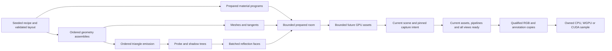

# Generation throughput: implementation and qualification

The objective is higher **completed** generation and training throughput with unchanged scene diversity, lighting, SSAA, annotations and seed behavior. A 2–4× improvement is an engineering target, not a measured capability. Completed native qualification includes a 1,024-room temporal run, a 128-room full-annotation retained-output/shutdown run, exact replay, and CPU/WGPU/CUDA consumer checks. A longer run recorded 6,713 accepted consecutive attempts before being stopped to bound qualification time; its planned 10,000-attempt gate and final shutdown checks remain incomplete. Finite evidence does not prove unlimited stability.

## Current pipeline

The source-bound [paper timing section](../tex/generated/pipeline_evaluation.tex) reports current measurements and their conditions. Branch times overlap; they must not be added as exclusive wall time. Shared-workstation measurements do not establish an isolated hardware ceiling.

| Area | Implementation and preserved contract |
| --- | --- |
| Capture scheduling | Pin scene, time, cameras, intrinsics, exposure, target and SSAA identity. Copy the first qualified render atomically across cameras. Temporal-history effects retain conservative settling. |
| Lighting readiness | Prime adaptive cluster depth for the current pose. Preserve cluster dimensions, light order, shadows and GI. |
| Camera search | Conservative spatial index followed by the original oriented-box intersection and tie rules. Preserve proposals and rejection decisions. |
| Material preparation | Reuse prepared transport-albedo evaluators, preserving coordinates, truncation, sRGB conversion, visual maps and normal/roughness mips. Independent selected screen, whiteboard and artwork atlases share the bounded native preparation pool; image/material binding retains surface/slot order. Raster fills clip once and reuse exact ellipse coordinates. Browser preparation synthesizes one atlas at a time between cooperative yields. |
| Geometry and transport | Release the assembly borrow after ordered triangle emission; construct trees and realize meshes/tangents concurrently without cloning the scene. |
| Primitive construction | Borrow one immutable unit-sphere mesh and reuse profile angles across revolved rings. The common cylinder has one fixed 21-entry table; other tessellations own temporary tables. Transformed vertices, metric inputs, topology and tangent generation remain unchanged. |
| Temporal annotations | Preserve static annotation vertices/indices across skin-only updates; upload only changed vertex spans. Reuse stationary flow surface pairs while refreshing camera uniforms and target-depth occlusion. Mesh/topology changes and missed generations retain full validation/upload. |
| Probe tree | Cache exact bounds/centroids in compact scratch and apply the existing median-split permutation in place. |
| Shadow-tree bins | Accumulate the three spatial histograms in one primitive pass, preserving each bin's insertion order, floating-point bounds, split ties and triangle traversal. Scratch storage is fixed per recursion level. |
| Reflections | Batch cube faces and probes over shared immutable inputs. Preserve rays, resolution, arithmetic and filtering. |
| CPU budget | One bounded preparation pool, normally eight workers, includes transport-tree construction. Caller, Bevy and driver threads remain separate. |
| Allocation | Fixed arrays replace cuboid temporaries. Existing bounded cluster-buffer recycling and recipe-sized material command buffers remain. |
| Material lifetime | Render-only aliases give PBR image slots distinct Bevy binding identities while sharing the same WGPU views/samplers. Sampler identities remain shared per slot across images and materials with identical complete filtering descriptions. This prevents stranded bindless capacity for shared packed maps and emissive screens without texture copies or dependency patches. |
| Diagnostics | Triangle emission, both trees, prepared assets, material slabs, GPU resources, live heap, allocator slack and completed latency are observable. Detailed lifetime observations are opt-in through `capture_endurance`. |

Native mesh preparation queues the largest parts first after reserving handles
in manifest order. Each task owns its geometry and is awaited asynchronously on
the shared bounded pool; canceled preparation drops its outstanding tasks. The
MikkTSpace algorithm and tangent repair are unchanged. When the preparation pool
has fewer than four workers, individual probe and shadow trees build serially;
independent material, geometry and mesh jobs still share the pool concurrently.
This avoids nested tree joins stealing long unrelated asset jobs before lighting
can start. Larger pools retain work-first tree forks: one branch runs on the
current worker before joining the other branch. No additional user setting or
worker pool is introduced.
Triangle order, node layout and bounds are checked against frozen references,
including complete generated rooms.

Native shadow traversal stores compact triangle positions and a source index;
UVs, normals and bound materials remain in the authoritative median tree. The
shadow records occupy 40 bytes per triangle instead of a second 80-byte complete
record on 64-bit native targets. GPU serialization resolves the original surface
attributes in the unchanged SAH order, and material binding scans only the median
triangles. Rebuilding the median permutation invalidates the shadow cache.
Four-triangle SIMD packets accelerate boolean shadow queries using the same
scalar arithmetic and intersection cutoffs; closest hits remain unchanged.
Frozen scalar queries, complete-tree replay and byte-level GPU-input checks guard
these paths. These are bounded CPU storage/kernel optimizations, not evidence of
a completed-render or training-throughput gain.

Content finish synthesis is separate from asset insertion. Scoped native joins
support both synchronous callers and one-worker preparation without blocking on
an undriven task. Only selected palette slots are synthesized, and all temporary
images belong to the current preparation. Skin/hair and artwork reuse exact
periodic hash lattices under per-build byte ceilings; no seed-keyed global cache
grows across rooms. Display smudges reuse separable squared coordinate terms and
skip rows outside their support. Scalar references check material values and every
generated mip, including overlapping marks and dormant/emissive screen bindings.
Content scheduling has exact CPU replay coverage but still needs performance
qualification: bounded shared-workstation trials do not establish a repeatable
complete-preparation speedup. Map/kernel savings alone are insufficient to claim
better completed rendering or training throughput.

Procedural screen, whiteboard and artwork rasterization clips opaque fills before
pixel work and reuses the exact divided/squared ellipse coordinates. Row slices
avoid repeated pixel bounds checks; RGB writes preserve destination alpha. Canvas
initialization fills its final RGBA pattern directly. A frozen scalar oracle
covers subpixel shapes, nested/empty clipping and edited alpha. These changes do
not alter coverage, image dimensions, filtering, material programs or RNG draws.
Integer median-tree comparison keys and different content scheduling were not
retained after their combined complete-preparation comparison regressed. The
retained raster kernel has exact replay coverage, but the bounded whole-room
measurements remain effectively flat. Only a complete-room comparison
can qualify a generation-throughput claim.

The Burn GPU stream also exposes per-sample CPU wall intervals through
`GpuLiveDataset::last_capture_timings()`, including CUDA allocation and transfer
fences. No additional GPU synchronization is introduced. These intervals are
outside deterministic sample identity; completed consumer work remains the
throughput denominator.

The alias layer changes only extracted render-world materials. CPU materials, source images and exported recipes remain unchanged. Pending uploads, render-world-only images and source removal preserve ownership. Non-bindless adapters use ordinary materials.

Consecutive lookahead remains bounded. Future entities, cameras and human motion inference do not enter the current room. Current copies submit before speculative GPU work; the existing 256 MiB upload budget and scene slots still apply. Explicit CPU-only admission holds do not advance the renderer. No dense room is replaced by an easier seed.

## Measurement and qualification

| Track | Contract |
| --- | --- |
| Reconstruction | Three 512×512 cameras, one timestep, density 0.65, humans 0.25, full native Auto lighting, 256 GI rays, RGB/depth/position/normal/semantic/co-visibility. |
| Temporal | Eight cameras, five timesteps, 256×256. The sustained RGB fixture explicitly disables humans; it does not measure inference or a production model. |
| JIT | Separate CPU, same-device WGPU and Linux CUDA paths. Complete consumer reductions and optimizer work; queued kernels are not completed throughput. |
| Correctness | Seeded geometry/material fingerprints; exact RGB/annotation replay; both glass policies; odd widths; SSAA; retained tensors; regeneration, recovery and shutdown. |
| Browser | WASM compilation and Chrome hardware WebGPU checks. Linux Vulkan evidence cannot qualify Apple M4/Metal hardware. |

Automatic SSAA remains enabled below the configured 720p pixel-count threshold. RGB uses area filtering; categorical/geometric targets retain aligned final pixel-center rays. Captured metadata stays attached to the exact requested state.

Matched runs use fixed populations and counterbalanced order. Failed-attempt cost remains in the denominator; rejected seeds are never replaced. No task-owned compiler or other benchmark runs beside throughput trials. Existing production workloads are not stopped. Before/after studies and raw traces remain local under ignored `out/`; the public page and paper describe only the current generator.

Release gates:

1. Exact CPU oracles across serial/parallel schedules, camera intersections, mesh/material fingerprints, BVH ordering and material evaluation.
2. GPU first-frame readiness, shadows, geometric targets, directed overlap, SSAA, maps/mips and CPU/WGPU/CUDA parity.
3. Repeated real Bevy bindless allocation/free cycles, requiring every resource to be released while retaining identical underlying GPU objects.
4. Persistent runs with separate attempted/accepted/rejected counts, retained-output checks, clean shutdown, CPU/GPU resources and latency. The planned 10,000-attempt gate was stopped before completion; observed resource trends are diagnostic. Completed shorter runs separately cover clean shutdown and retained output. Finite qualification does not prove unlimited stability.
5. Strict Clippy, workspace tests, WASM, current-source publication receipts, package inspection, exact-commit CI and registry provenance. The owning training thread separately qualifies the production continuation.

A known typed rejection remains a rejected attempt. It must not disappear from acceptance statistics or be silently replaced during a comparison.

Primitive and spatial-bin microbenchmarks measure CPU construction kernels only.
Their exact oracles cover transformed/mirrored geometry, UV seams, tangent frames,
coincident centroids and serial/parallel tree ordering. Complete preparation
comparisons additionally match seeded manifests, mesh attributes/indices and CPU
material/reflection maps. These checks do not replace completed WGPU/CUDA consumer
or concurrent-training measurements. The primitive cache has fixed process
residency; it never retains generated rooms, transformed meshes or seed-keyed data.

## Conditional branches and stopping decisions

| Candidate | Decision |
| --- | --- |
| Replace ChaCha8 or use a small random table | Retain domain-separated streams. RNG is not established as the limiting work; changed draws would alter content and correlations. |
| Approximate SIMD, fast-math or alternative tangents | Retain exact arithmetic and MikkTSpace. Accept contiguous scratch and reused calculations; approximations require independent qualification. |
| Deeper prefetch or more renderer workers | Retain bounded defaults. Preparation is frequently already hidden; more queued rooms consume memory and compete with training. |
| WGSL reflection-ray traversal | CPU probe/face batching is implemented. A GPU replacement remains conditional on a matched radiance oracle and a completed-training win. No unqualified backend ships. |
| More GPU material families | Keep qualified GPU programs and CPU oracles. Further coverage requires map/mip parity and concurrent-training evidence. Offloading CPU work alone is not a gain. |
| GPU scene/BVH construction | Deferred: placement, O-voxel, visibility and semantic attachments must share exact geometry without ordinary capture readback. |
| Separate completion workers | Retain bounded delivery; another queue requires evidence that conversion is exposed on the critical path. |
| New CUDA synchronization contract | Keep tested external memory and Burn-owned outputs. Asynchronous import requires upstream ownership/readiness support, not an implicit Cargo patch. |
| Two active render scenes, large arenas or new instancing | Conditional architectural work requiring light/shadow/reflection/annotation isolation and output-lifetime proofs. |
| Allocator replacement, trimming or worker restarts | Do not conceal retained resources. Fix ownership and accounting; distinguish live allocations from reusable pages. |

The WGPU API uses Bevy's device/queue and a texture-to-storage GPU copy without a host image roundtrip. CUDA uses external memory, a GPU copy into Burn-owned storage and producer/consumer synchronization. Neither path claims direct image aliasing as an ordinary Burn tensor.

## Downstream continuation

Use ordinary `LiveDataset`/`GpuLiveDataset` entry points and preserve quality and recipes. Multi-process owners should review explicit preparation-thread overrides: one budget now covers the shared preparation pool rather than two independent pools of that size.

Upgrade at a checkpoint and controlled producer rollover. Verify numerical replay, all targets, finite losses/gradients, completed optimizer steps, input-blocked time, ready reserve and resource trends before long continuation. Preserve checkpoint lineage, objectives, batch/precision and the currently authorized schedule. Generator qualification does not certify an unobserved production training run.
