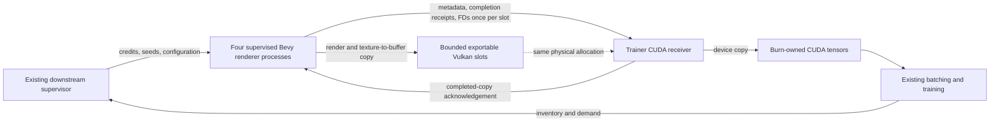

# Configurable GPU capture and supervised CUDA renderer processes

Status: design baseline, 2026-10-18. The local implementation and its explicit
qualification boundaries are documented in [GPU process capture](gpu_process_capture.md).
The source findings below describe the review baseline, not the updated API.
Review baseline: `c60d5bd462cde32539e449e40f2e5c1c64c70460`,
`bevy_zeroverse 0.44.2`, `bevy_zeroverse_burn 0.28.2`, Bevy 0.20.0,
Burn 0.22.0, CubeCL 0.11.0 and wgpu 30.0.1.

The recommendation is to first make requested outputs authoritative, then add a
GPU transport that attaches to externally supervised renderers. For Linux NVIDIA
CUDA, share exported Vulkan allocations across processes and copy their contents
into trainer-owned Burn tensors. This preserves process supervision and avoids
host image transfers using the published dependency graph. Direct foreign-memory
Burn tensors are a subsequent upstream-dependent optimization, not a prerequisite.

## Findings at the review baseline

| Area | Verified behavior | Consequence |
| --- | --- | --- |
| Execution | [`gpu/worker.rs`](../crates/burn/src/gpu/worker.rs), `with_transport`, starts a thread, channels of capacity one, and one renderer inside the caller process. `next_sample` automatically requests one future room. | There is no public endpoint for the existing four supervised renderer processes or their capture credits. Adding four instances inside the trainer is not equivalent process supervision. |
| Explicit seeds | `GpuLiveDataset::sample_seed` drains pending work and sends an indexed request that resets the sequence. The worker otherwise expects its prepared successor to be `seed + 1`. | Calling `sample_seed` for every admitted request would discard useful preparation overlap. Explicit multi-lane scheduling needs a bounded queue of actual seed/sequence requests, not a wrapper around indexed capture. |
| Outputs | [`gpu.rs`](../crates/burn/src/gpu.rs), `Renderer::with_transport`, unconditionally appends Color, Depth and Normal. `GpuView` has mandatory color, world/depth and normal/semantic tensors; packing assumes fixed plane indices. | A Color-only request actually requests the geometric annotation pass and transfers three planes. Removing just the configuration override would leave incorrect tensor packing and an incompatible return contract. |
| Renderer | [`capture_targets.rs`](../src/camera/capture_targets.rs) already skips `GroundTruthCamera` for a native Color-only capture. Geometric capture uses a paired world/depth plus normal/semantic MRT. [`extract_geometry`](../src/render/ground_truth/extract.rs) returns early when there are no ground-truth cameras. | RGB-only support can eliminate annotation extraction/uploads, the annotation raster, and two copied planes. Normal PBR depth/prepasses, shadows, SSAA, lighting and material baking must remain intact. |
| Configuration | `new` and `new_cuda` accept the full `BevyZeroverseConfig`. The transport requires indoor scenes, rejects O-voxels, sets headless flags, obtains assets from process globals, fixes preparation depth to three, and has a hardcoded 120-second capture loop deadline. Initialization/receive/join are blocking. | Scene controls already exist. The gaps are faithful output selection, common validation/conversion, runtime controls and execution topology; a second reduced scene configuration would worsen parity. A loop deadline cannot interrupt a driver call that itself hangs. |
| Dataset controls | [`LiveDatasetConfig`](../crates/burn/src/dataset.rs) and [`GenConfig`](../crates/burn/src/generator.rs) provide assets, timeouts and archive/runtime policy. [`CaptureControl`](../crates/burn/src/generator/admission.rs) already supports whole-room credits, hold/cancel and typed rejection accounting. | Reuse these semantics; the GPU worker currently does not integrate them. Archive paths/codecs are not GPU transport settings. |
| Sensor effects | [`sensor.rs`](../crates/burn/src/sensor.rs) applies optional RGB transforms on the CPU export worker. The downstream GPU adapter explicitly rejects these effects. | Do not silently omit a requested sensor transform or add an undisclosed host readback. GPU sensor parity is separate work. |
| RGB encoding | GPU capture returns tone-mapped linear RGBA float32. The archive packer in [`chunk.rs`](../crates/burn/src/chunk.rs) applies [`linear_to_srgb`](../src/render/color.rs) to RGB before export; the downstream raw loader requires sRGB float32 RGB and `color_encoding=2`. | Direct training integration must perform this same conversion on the GPU, including the existing clamping and channel/layout contract. Feeding linear RGB into the existing training pipeline is not equivalent input. |
| CUDA transfer | [`cuda/memory.rs`](../crates/burn/src/gpu/cuda/memory.rs) creates dedicated device-local Vulkan buffers, exports opaque FDs and imports them into CUDA. [`cuda/mod.rs`](../crates/burn/src/gpu/cuda/mod.rs) copies into Burn-owned storage and fences its transfer stream. | Already no host image roundtrip, but two base GPU copies: texture to shared buffer, then shared buffer to Burn storage. Moving the importer to the trainer process need not add another image copy. |
| Ownership | The bridge verifies Vulkan/CUDA device UUID and local CUDA allocation context, retains allocator reservations, pools shared buffers and poisons failed transfers. | Preserve these checks. Rust `Arc`, a `wgpu::Buffer`, a CUDA pointer and an in-process CUDA context handle are not an IPC contract. |

Downstream source was inspected read-only in `/home/mosure/repos/burn_gekko`:

- `crates/burn_gekko_capture/src/lib.rs` resolves shared capture settings and
  deliberately requests Color only for RGB training. Its `scene_config` manually
  copies fields from `GenConfig`; the GPU constructor then expands the modes.
- `crates/burn_gekko_train/src/training/input/source.rs` owns child identity,
  startup configuration, logs, publication verification and process termination.
  `source/cooperative.rs` handles cumulative credits and inventory;
  `source/credits.rs` distinguishes returned native-rejection credits from
  completed publications. `renderers.rs` supports explicit GPU/CPU lane placement.
- The reviewed production pathway consumes host-backed `TrainingRoom` data from
  archives. A device transport also needs a downstream GPU batch adapter; merely
  replacing the producer command would preserve an unwanted CPU conversion.
- The requested four-process topology is the integration target, not a newly
  measured optimum. No running trainer or process layout was changed or audited.
- The downstream review in `.data/experiments/120-dispatch/interop-review.toml`
  and production-route description in `docs/gpu-efficiency.md` were also read.
  Their reported timings are downstream evidence, not a new qualification here.

## What cross-process zero-copy means here

Yes, processes can access the same device allocation without copying image bytes
between them. Vulkan opaque FDs explicitly support cross-process transport using
Unix-domain `SCM_RIGHTS`, and CUDA can import external memory and synchronization
objects. This supports an implementation using the same physical NVIDIA GPU.
It does not make a renderer texture an ordinary Burn tensor automatically.
See [Vulkan handle semantics](https://docs.vulkan.org/refpages/latest/refpages/source/VkExternalMemoryHandleTypeFlagBits.html)
and [CUDA external interoperability](https://docs.nvidia.com/cuda/cuda-driver-api/cuda_driver_api/group__CUDA__EXTRES__INTEROP.html).

| Path | Image movement | Proposed status |
| --- | --- | --- |
| Current archive/host path | GPU to host, archive/decode as configured, host to training GPU | Retain as explicit reference/fallback transport. |
| Current in-process WGPU | Bevy texture to Burn-owned buffer on the same device/queue | Preserve the existing fast path. |
| Current in-process CUDA | Bevy texture to shared Vulkan buffer; shared mapping to Burn CUDA storage | Preserve compatibility and use as a parity oracle. |
| First multi-process CUDA implementation | Bevy texture to exported Vulkan buffer in child; same allocation imported in trainer; device copy into Burn storage | Recommended production milestone. Zero host image bytes; no additional base GPU copy caused by IPC. |
| Foreign-memory Burn tensor | Bevy texture to shared buffer; Burn tensor directly references imported storage | Requires upstream ownership, readiness and completion integration. Still a texture-to-linear-buffer operation. |
| Direct render-target alias | CUDA accesses exported render images directly | Deferred. Image tiling, formats, SSAA/resolve and tensor layouts make this substantially different from a linear tensor import. |

These are base-copy counts, not a claim that slicing, row depadding, layout
conversion, fusion or batching never schedules more device work. Measure those
separately. Sharing an allocation also does not eliminate GPU memory-bandwidth
contention, renderer CPU costs or graphics/compute scheduling costs.

Do not call `cuIpcGetMemHandle` on arbitrary CubeCL pointers or a Vulkan-imported
mapping. Its documented input is the base of a `cuMemAlloc` allocation; ordinary
tensor pointers may be suballocations or asynchronous-pool allocations. CUDA VMM
has a separate shareable-handle API, but it is not a drop-in exporter for an
arbitrary Burn allocation. Export the Vulkan allocation directly instead.
[CUDA legacy IPC](https://docs.nvidia.com/cuda/cuda-driver-api/cuda_driver_api/group__CUDA__MEM.html),
[CUDA VMM sharing](https://docs.nvidia.com/cuda/cuda-programming-guide/04-special-topics/virtual-memory-management.html).

## One capture policy across transports

Introduce a resolved capture specification shared by archive, native GPU and IPC
entry points. Keep `BevyZeroverseConfig` as the scene source of truth. Add a full
`GenConfig` conversion method so downstream stops rebuilding it field by field.
Normalize once, validate once, return the effective configuration and its hash.
Transport/runtime limits must not silently alter the scene or requested labels.

Proposed concepts, with names subject to implementation review:

| Type | Responsibility |
| --- | --- |
| `CaptureSpec` | Scene configuration, explicit color-output encoding/layout and optional sensor policy; resolution, views, times, output modes and all scene controls have one source. |
| `ResolvedCaptureSpec` | Immutable validated configuration, output/dependency plan, estimated bytes and capture-policy fingerprint. |
| `CaptureRuntimeOptions` | Asset root, initialization/capture/shutdown deadlines, bounded memory/lookahead and optional process-local CPU budget; defaults remain automatic. |
| `CaptureControl` | Reused whole-room admission/hold/cancel and rejection accounting. Refactor internal permit handling instead of cloning an independent scheduler. |
| `GpuLiveDataset` | In-process convenience wrapper over the common capture session. |
| `GpuCaptureServer` | Serve one renderer on an inherited connected socket. Embeddable by the downstream capture executable; it does not own the supervisor. |
| `CudaCaptureReceiver` | Attach existing supervised connections to the trainer's existing Burn CUDA device; import/validate allocations and deliver owned tensors. |

Scene parity includes layout, density, people, both human and furniture motion,
camera distributions and trajectories, physical/normalized time, exposure,
appearance, GPU material selection, lighting/GI/shadows, SSAA, glass policy and
rotation augmentation. Calibration, poses, object labels and bounds must remain
attached to the matching views. Changing transport must not change seed draws,
camera order, time progression, readiness or geometry validation.

Requirements for the public API:

1. `render_modes` determines logical outputs. Resolve an empty list through
   `render_mode` exactly once; do not accidentally union a stale viewer mode
   into a headless dataset request. Reject unsupported modes before capture.
2. Replace mandatory image tensors, including color, with optional/named planes and checked
   accessors. Missing means not requested, never a zero-filled fake annotation.
   Remove fixed indices from sampling, packing, flow shifting and buffer pooling.
3. Record raw plane semantics explicitly. Metric camera-Z versus radial or
   normalized depth, encoded view normals, semantic IDs, co-visibility masks,
   color encoding and optical-flow validity cannot be inferred from channel count.
   Canonical packed planes may have derived views; honor supported formatting
   requests or reject them, rather than silently returning another convention.
4. Keep the annotated `indoor()` preset explicit. General constructors must honor
   a Color-only request. Optional fields change the public return type: use an
   appropriate adapter minor release and a migration example, not an unnoticed
   patch-level source break or a permanent hidden annotation override.
5. Permit caller-supplied asset roots and an existing CUDA training device. Select
   the Vulkan adapter to match that device, rather than requiring the trainer to
   rebuild its model around whichever adapter the child selected.
6. Resource defaults should work without tuning. Advanced aggregate memory/CPU
   budgets are validated overrides, not a requirement to configure each queue,
   stream, allocator or thread. CPU pool configuration must precede initialization.
7. Controlled capture must not automatically launch an uncredited future GPU
   capture. Already admitted work completes under its watchdog; CPU preparation
   may finish during a hold. Preserve the existing prohibition on new idle GPU
   work in controlled generation.
8. Keep archive-only operations explicit. O-voxel capture, archive compression
   and schematic export need capability reporting, not dropped fields. Initially
   reject GPU sensor transforms until separately implemented and qualified.
   Non-indoor scene support is also a separately tested capability.

Illustrative API shape, **not currently callable code**:

```text
spec = CaptureSpec::from_scene(scene_config)
    .color_output(ColorOutput::SrgbRgbF32)
    .resolve()
// scene_config.render_modes = [Color] means only RGB delivery.
// CaptureSpec::from_gen(gen_config) resolves the same capture policy.
// sRGB conversion and RGBA-to-RGB packing execute on the GPU.

// Standalone convenience: automatic bounded worker and shared configuration.
rooms = GpuLiveDataset::builder(spec)
    .runtime(runtime_options)
    .cuda_on(existing_training_device)
    .build()

// Production: downstream retains its four children and credit scheduler.
rooms = CudaCaptureReceiver::attach(
    existing_training_device, spec, supervised_connections, runtime_options)
rooms.plan_requests(bounded_ordered_seed_queue) // CPU preparation, not capture credits
rooms.admit(request_sequence, exact_seed, lane)
sample = rooms.receive_completed(deadline, cancellation) // any completed lane
// try_receive() is also available; downstream restores its chosen training order.
```

The explicit production request is backed by the same admission accounting as
`CaptureControl`; it is not a second, independently incremented credit counter.
The supervisor assigns the seed/sequence and chooses delivery order. A receiver
may report completed slots out of order, but it must not silently reorder the
training schedule. Per-room metadata and tensors travel as one transaction.

Explicit requests must retain prepared-scene lookahead. Prepare the actual bounded
ordered request list with configuration-sensitive keys, including nonconsecutive
or lane-strided seeds. Reuse the matching prepared scene without resetting the
whole sequence. CPU preparation reservations do not grant permission to render.
A hold prevents new GPU capture and preserves valid prepared work; intentional
demand waits do not run down capture watchdogs. Superseded preparation is retired
and counted explicitly. Invalid seeds produce terminal reason/seed/sequence and
credit receipts. Retrying a lane cannot reset other lanes, repeat accepted rooms
or fabricate new credits; transport retry and scientific scene rejection are
different outcomes.

The control plane needs nonblocking receive, bounded/cancellable receive and
notifications from any ready lane. Admission must provide bounded backpressure,
not indefinitely block the caller on a full channel. Imports, GPU completion
polling and tensor conversion run off the control thread. An idle lane must not
prevent collection and retirement of another lane's completed work. If training
requires an earlier room, use a bounded reorder buffer under downstream policy;
do not silently switch to completion-order training or accumulate unlimited
future rooms. Timeout/cancellation is not a claim that a driver call can be killed.

### Logical outputs versus required renderer work

Maintain an `AttachmentPlan` containing requested outputs, internal dependencies,
rendered planes and copied planes. Send that plan in the handshake and capture
receipt; allocation sizes and packet parsing derive from it.

| Request | Required work |
| --- | --- |
| Color only | Existing full-quality RGB rendering and its own required prepasses; no Zeroverse ground-truth camera, annotation mesh upload, annotation MRT, flow history or co-visibility pass. |
| Depth and/or position | Current world/depth plane. The paired normal/semantic MRT remains an acknowledged internal dependency until an output-mask shader variant is qualified. Do not copy/export unused planes. |
| Normal and/or semantic | Current normal/semantic plane with paired MRT dependency initially. Preserve exact label and normal conventions. |
| Flow | Keep the preceding/current geometry and camera state needed for the flow oracle. Dependencies do not become public outputs unless requested. Terminal flow validity remains explicit. |
| Co-visibility | Keep required peer-camera depth/geometry and membership computation. Dependencies remain separate from exported labels. |

First remove the entire annotation pass for RGB-only. Then specialize the paired
MRT for partial annotation requests if measurements justify its shader/pipeline
complexity. Do not promise that omitting a semantic output eliminates a geometric
pass that requested flow still needs. Renderer-internal depth is not an exported
depth annotation.

### Required GPU color conversion for training

Make linear-to-sRGB preprocessing part of phases 1 and 3, not an optional
post-integration tune-up. Keep the existing raw GPU interface's linear RGBA
contract available; add an explicit typed output selection such as
`ColorOutput::SrgbRgbF32` for training. The downstream adapter must request this
selection and check the resolved output contract. It must not infer encoding
from the tensor dtype, channel count or backend. Generic raw capture must not
silently change its historical encoding.

The authoritative CPU oracle is `render::color::linear_to_srgb`, already used by
the archive exporter. For each finite RGB component, using float32 arithmetic:

```text
x = clamp(linear, 0, 1)
srgb = 12.92 * x                         when x <= 0.0031308
       1.055 * pow(x, 1 / 2.4) - 0.055   otherwise
```

Use the piecewise transfer, not approximate gamma 2.2, another tone map,
exposure correction or per-image normalization. Nonfinite source values are a
capture failure; clamping must not conceal them. Alpha is not color: preserve
it unchanged when RGBA is requested, or drop it for RGB. Do not introduce new
premultiplication, compositing, channel reordering or integer quantization.

The operation order is:

```text
PBR/exposure/tone mapping -> linear RGBA -> existing linear-space SSAA resolve
  -> GPU RGB transfer to sRGB -> alpha removal/layout packing -> training input
```

The archive exporter converts after the final image is resolved; gamma encoding
before area averaging would change boundary and high-frequency colors. Preserve
camera/time ordering and all calibration metadata through packing. Keep depth,
normal, position, semantic IDs, flow and co-visibility outside this conversion.

Provide a cached, fused GPU conversion/packing kernel in a focused module such
as `crates/burn/src/gpu/color.rs`, shared by WGPU and CUDA through the published
Burn/CubeCL APIs. It should combine the transfer function, row depadding and
RGBA-to-RGB packing into one pass where the layout permits. No `into_data`,
host image staging or GPU-to-CPU-to-GPU conversion belongs in this path.

For initial CUDA IPC, first perform the proven copy into managed Burn storage,
then run the conversion on that storage. The converted tensor's dependencies
must be tracked by Burn before delivery; returning after enqueue is safe only
under the backend's normal cross-stream tensor dependency contract. Retain raw
source storage until the conversion completes. A later kernel that reads the
external mapping directly and writes packed sRGB could replace the copy plus
conversion, but requires its own external-memory lifetime and synchronization
qualification. Do not assume an unregistered external pointer is a Cube tensor.

Record source encoding, delivered encoding, transfer-function version, dtype,
layout and alpha policy in the resolved contract and capture receipt. For a
converted sample, `metadata.color_encoding` must describe the delivered sRGB
tensor; preserve the raw source encoding separately in transport metadata.
Already-sRGB inputs bypass the transfer, and unknown/legacy encoding fails
unless an explicitly supported conversion is selected. This prevents downstream
and future sensor pipelines from applying the transfer twice. Sensor effects
remain separately configured and qualified; canonical color encoding does not
depend on enabling them.

Match downstream's current HWC three-channel float32 sRGB `[0,1]` input before
its existing model-specific normalization/patchification. Those subsequent
training transforms remain downstream-owned. A raw archive reference is the
parity target; JPEG quantization is not an implicit part of GPU preprocessing.
Test raw linear delivery separately from requested sRGB delivery.

Required qualification includes endpoints, the piecewise threshold and adjacent
float32 values, negative/above-one finite inputs, neutral ramps, saturated colors,
nonfinite rejection, alpha retention/removal, odd widths/padding and multi-view
time ordering. Check `0.18 -> approximately 0.4613561` and compare a dense ramp
plus seeded images against the existing CPU oracle on WGPU and CUDA. GPU `pow`
may differ slightly from CPU `powf`; measure and document a tight absolute/ULP
error bound rather than claiming bit-exact transcendental arithmetic. Copies,
channel permutations and integer annotations retain their exactness requirements.
Check specifically for missing or doubled encoding, and include end-to-end
training preprocessing/forward parity under an agreed numerical tolerance.

Include conversion/packing time, dispatches and scratch/output memory in
completed-batch and concurrent-training measurements. The earlier 12 MiB RGB
slot example remains linear RGBA transport storage: three 512-square sRGB RGB
outputs occupy 9 MiB, and temporarily retaining both costs 21 MiB before other
buffers. Do not count a three-channel output as eliminating the raw ingress
allocation until the fused-ingress implementation actually does so.

## Process architecture



Keep child ownership, restart policy, PID identity, checkpoint state, input
inventory and seed scheduling downstream. Provide a server function and a thin
official executable entry point; accept already connected sockets so a custom
supervisor need not be replaced. Fresh processes use exec and initialize their
own renderer; they never reuse inherited live CUDA/Vulkan state after fork.

Refactor the current bridge into a Vulkan exporter and a CUDA consumer. The
exporter need not initialize Burn or CUDA. The receiver uses the trainer's chosen
CUDA context locally. One receiver can multiplex four producer connections;
waiting for one lane must not block ready data from the others. Keep the selected
training schedule deterministic rather than silently changing sample order to
whichever room finishes fastest.

Use a bounded Unix-domain protocol with ancillary FDs, not numeric FD values in
JSON and not a CUDA pointer serialized as an integer. Authenticate the local
peer/owned child, limit message/FD counts and reject truncated or malformed
messages. This transports trusted local renderer output, not untrusted GPU code.

### Handshake and wire contract

- Protocol version, generator/capture identity, package versions, asset identity,
  canonical capture-policy hash and supported transport/annotation capabilities.
- Device UUID, Vulkan driver identity and actual API/driver versions. Compare
  UUIDs, not ordinal numbers, especially under `CUDA_VISIBLE_DEVICES`. CUDA
  context pointers are only meaningful within their own process.
- Run/session ID, lane ID, worker incarnation, request sequence and explicit seed.
  Replacing a process changes its incarnation even when an OS PID is reused.
- Immutable per-session resolution, view/time counts, SSAA policy, output plan,
  color/geometry conventions and calibration schema. Reconfigure through a new
  session after draining, rather than resizing live leased slots.
- Slot ID/generation, allocation size, dedicated-allocation flag, handle type,
  offsets, row/plane strides, logical shape, dtype, byte lengths and alignment.
  Check arithmetic, non-overlap, bounds and device limits before importing.
- Register/export each allocation once, acknowledge import, then reference slot
  IDs in captures. Maintain a matching imported synchronization object per slot
  or an equivalently proven sequence protocol. No export/import call per frame.
- Include explicit camera index, timestep index, normalized progress and physical
  time where defined for every view, alongside stable room/request/session IDs,
  metadata and timings. Timestep-major array order remains specified but is not
  the only way to identify a view. This supports GPU target/reference gathering
  without guessing identity from offsets. Publication/acceptance and returned-credit
  receipts preserve the existing typed rejection policy. GPU delivery is not a
  durable archive publication.

Keep the serializable descriptor/identity definitions in the lightweight
`bevy_zeroverse_capture` crate. Keep OS handles, sockets and unsafe Vulkan/CUDA
operations in native implementation modules. Share renderer attachment planning
in core; keep Burn tensor assembly in `crates/burn`. Separate wire, lifecycle,
Vulkan allocation/synchronization, CUDA import/copy and worker orchestration so
state-machine tests do not require a GPU.

### Synchronization and ownership

Use a deliberately conservative first implementation:

1. Reserve a bounded room slot before admission. Render every required view and
   timestep only after normal scene/material/motion readiness.
2. Copy final output textures into the slot, release Vulkan queue-family ownership
   to the external consumer and signal the slot semaphore. Keep WGPU's tracked
   state consistent; submit through its queue/HAL interfaces, not an unsynchronized
   raw `vkQueueSubmit` competing with Bevy.
3. Announce `Ready` only after the producer observes completion of the submission
   containing that signal and release. Prefer completion callbacks/nonblocking
   polling so CPU preparation and other slots can progress. A render-graph
   encoding stamp or submission acknowledgement alone is insufficient.
4. The CUDA ingress worker imports the registered mapping, waits on the completed
   signal, obtains fresh Burn destination storage and fences its allocation work.
   Copy on a dedicated local CUDA transfer stream, retaining `ManagedResource`
   reservations. Do not publish tensors until the copy completes.
5. After copy completion, acknowledge release. The renderer reacquires Vulkan
   ownership before writing that slot again. A dropped host wrapper or receipt
   alone does not mean GPU reads have finished. A binary signal has one wait;
   duplicate messages cannot consume or recycle it twice.
6. Returned Burn-owned tensors are independent of the renderer and IPC slot.
   They remain valid through later captures, worker replacement and shutdown.

The extra producer completion gate is intentional for supervision: do not enqueue
an unbounded CUDA wait for a signal that a crashed or paused producer might never
issue. A separate ingress stream alone does not make an unsatisfied GPU wait
cancellable. This gate can overlap across workers and with training, but its
latency must be measured. Use finite control-plane deadlines and event polling;
there is no safe general guarantee that a timeout can cancel a hung driver call.

Vulkan opaque FDs retain a reference to the exported allocation independently of
the original memory object. Retain an owned duplicate reference until the CUDA
import and any pending reads are retired; successful CUDA FD import consumes the
transferred descriptor. Qualify producer termination both before and after a ready
receipt rather than relying on process-lifetime assumptions.
[Vulkan FD lifetime](https://docs.vulkan.org/refpages/latest/refpages/source/VK_KHR_external_memory_fd.html),
[CUDA import/destruction rules](https://docs.nvidia.com/cuda/cuda-driver-api/cuda_driver_api/group__CUDA__EXTRES__INTEROP.html).

On worker loss before readiness, fail the request without submitting a wait and
quarantine its slots. On loss after readiness, retain imports until any started
copy completes; never publish partial tensors. On CUDA/device loss, fail closed
and let the training owner recover from its checkpoint. Process supervision cannot
promise isolation from a fault that resets the shared physical GPU.

Drain/cancel semantics must distinguish unadmitted work, admitted captures,
pending copies and delivered tensors. A normal shutdown joins after retirement;
a watchdog may terminate an owned hung renderer. Keep cleanup paths from
silently blocking the trainer's main thread indefinitely. Track and bound
quarantined resources; repeated failures must stop admissions rather than leak
one old allocation pool per replacement.

Timeline semaphores can later reduce bookkeeping and express generations.
Current published WGPU HAL supports staged external signal/wait operations, and
CUDA documents Vulkan timeline interoperability. They do not by themselves fix
Burn tensor ownership or a wait on a producer that died before signaling.
[WGPU Vulkan queue API](https://docs.rs/wgpu-hal/30.0.1/wgpu_hal/vulkan/struct.Queue.html),
[NVIDIA Vulkan interoperability](https://docs.nvidia.com/cuda/cuda-programming-guide/04-special-topics/graphics-interop.html#external-resource-interoperability).

### Pause, replacement and resolution transitions

Qualify hold/resume and the real 256-to-512 transition as separate lifecycle
tests. Stop new admissions, account for admitted captures and generated but
unconsumed rooms, and let the downstream input ledger decide which retained
rooms to consume, preserve or explicitly retire. Do not silently discard them
and resample. Drain GPU reads before retiring slots/imports and replace only the
owned workers that need a new capture specification. Establish a new session
identity and descriptor set; restarting local credit or slot-generation counters
does not reset the logical request/seed ledger or identify a new accepted room.

Checkpoint and input-ledger ownership remain downstream. Already delivered
Burn-owned tensors must survive renderer shutdown and remain readable on the
training thread/stream. Synchronize only the affected transfers/resources, not
the whole training device, and require no CUDA context reset. Measure RSS, FDs,
registered/imported/leased/quarantined bytes across both pool reuse and repeated
worker replacement. They must plateau at their configured budgets plus explicitly
retained tensors; compare after those retained tensors are released as well.

## Bound memory and preserve the happy path

Use an automatic small slot pool, initially one active plus one future room per
renderer subject to an aggregate byte ceiling. Capture credits and allocation
credits are distinct. Reserve across all lanes before admission, and include
imported pools, in-flight destination tensors and ready inventory in accounting.
Do not let each of four processes independently reserve all available VRAM.

For the current RGBA32Float packed layout:

`room_slot_bytes = views × timesteps × copied_planes × height × align_up(width × 16, 256)`.

At 512×512, three cameras, one timestep, this is **12 MiB for RGB** versus
**36 MiB for the forced three planes**. With four renderers and two slots each,
that is **96 MiB versus 288 MiB**; three timesteps multiply both by three. These
are calculated output-slot sizes, not measured total VRAM. Bevy render targets,
SSAA intermediates, geometry/materials, shared import references, Burn destination
copies, training activations and retained batches must also be budgeted. Imported
mappings reference the same backing memory; do not count that backing twice.

Aggregate several view outputs into a registered room arena if it reduces handle
overhead without increasing waiting or retention. Keep final float32 precision
and exact row conventions. A GPU packing operation may later combine depadding,
channel selection and training layout conversion; benchmark it against copies
and preserve bit patterns where the operation is only a permutation.

At the production forty-view room size, bulk delivery is an acceptance concern,
not only a later micro-optimization. Prefer one registered room arena or a
measured equivalent with exact offsets/strides and bounded retention. Batch
allocation readiness and copy completion rather than adding a CPU fence,
import/export or normalization-constant upload for every view. Fuse GPU depadding,
linear-to-sRGB conversion and RGBA-to-RGB packing where supported. Deliver a
device-resident room representation for downstream target/reference gathers;
never convert it back to `TrainingRoom` host images or `Vec<f32>` in the live
training path. The archive/evaluation adapter stays a separate explicit path.

Prefer owned Burn output for the first production API: a slow consumer pins its
own tensors, not a renderer slot. Release slots after ingress copy completion,
not after backward. Bound the consumer inventory separately. Caller-retained
tensors can still exhaust memory and need an explicit ownership/budget contract.

RGB-only mode must show zero annotation geometry uploads and zero host image
readback allocations/transfers. Small CPU metadata and optional validation
reductions are permitted and accounted separately. Existing preparation/upload
lookahead must retain its budgets and avoid competing with a held capture.

Expose counters for actual host image reads/writes and transferred image bytes,
separate from metadata/control bytes, audit-only downloads and GPU device-copy
bytes. Check these counters against an instrumented transport trace: an empty
metadata image vector alone does not prove no host image transfer occurred.

## What direct imported Burn storage still needs

The inspected CubeCL 0.11.0 CUDA `GpuStorage` owns its allocation map and frees
its entries using its own allocation kind. `ComputeClient::get_resource` exposes
a managed resource from existing storage; it is not a foreign-allocation import.
There is no public foreign allocation owner plus external readiness/completion
contract in this path. `GpuResource::new` alone does not register tensor storage.
The current bridge correctly uses a managed destination plus device copy.

An upstream API would need all of the following before removing that copy:

- An imported allocation lease with a destructor appropriate to CUDA external
  memory, shape/strides/offset validation and accounting independent of CubeCL's
  normal allocator. Never forge a storage handle or transfer ownership to
  `cuMemFreeAsync` for a foreign mapping.
- Producer readiness integrated into every relevant consumer stream and error
  propagation, rather than assuming first use occurs on one known thread.
- Last-use completion across aliases, views, fusion, autograd, cross-stream
  operations and CUDA graph capture before releasing a renderer slot.
- Protection against in-place mutation of shared renderer storage, or a clearly
  enforced exclusive writable lease. Graph-referenced slots cannot be recycled
  while a graph may replay against them.
- Explicit failure/lifetime semantics when either process exits and bounded
  reclamation without a global training-device synchronization.

Do not make full zero-copy a condition for removing the current host archive
path. Do not add global Cargo patches: features cannot conditionally scope a
workspace `[patch]`. The native Linux IPC feature remains opt-in; existing WGPU,
WASM and default dependency graphs remain portable and publishable. Browser
WebGPU has no native opaque-FD CUDA transport. Cross-GPU, Windows and software
Vulkan lanes are outside the initial CUDA IPC contract and must fail clearly or
use an explicitly selected host transport.

## Delivery order and acceptance gates

| Phase | Work | Required exit evidence |
| --- | --- | --- |
| 1. Configuration and output parity | Shared resolution/validation; optional named planes; faithful RGB-only mode; explicit raw-linear or GPU-converted sRGB output; asset/runtime/deadline/admission controls; API migration. | Config roundtrip and supported/unsupported capability tests. RGB-only capture has no annotation work; GPU sRGB matches the archive CPU oracle, with encoding/alpha/layout tests. Existing annotated capture remains correct. |
| 2. Transport-neutral process contract | Server entry point, socket protocol, explicit-seed preparation queue, asynchronous multiplexed delivery, identities, descriptors, bounded credits and rejection receipts. | CPU state-machine tests for preserved lookahead, lane-independent completion/retry, duplicate/stale messages, cancelled admission, timeout, returned credits and slot accounting. Supervisor ownership and training order are preserved. |
| 3. CUDA IPC with owned outputs | Separate Vulkan export/CUDA import; registered pools; completed-readiness gate; trainer-device matching; device copy into managed Burn storage and requested GPU sRGB preprocessing. | One then four supervised processes; exact raw transport replay plus qualified sRGB parity, retained tensor lifetime, zero host image bytes, no unneeded output planes, no silent fallback. Explicit crashes at each protocol stage retire or quarantine safely. |
| 4. Downstream batching and qualification | Production-shaped device room/batch adapter; temporal grouping, schedule, color conversion, target/reference gathering, graph consumption and checkpoint/input state. | Matched forward/loss/gradient/optimizer replay, completed training throughput, bounded resources through pause/resume, replacement and 256-to-512 transition. No model/recipe/quality changes. |
| 5. Evidence-driven copy/fence reduction | Arena packing, async ingress after an upstream readiness hook; direct imported storage only after its full lease contract exists. | A completed-training improvement with all phase 3–4 lifetime/correctness gates retained. Do not ship an unsafe zero-copy shortcut to meet a headline target. |

Phase 1 is independently useful and should not wait for IPC. Phase 3 can ship
with published dependencies without phase 5. The latter remains a conditional
upstream project, not an implementation promise inside Zeroverse alone.

### Qualification matrix and bounded experiments

Mandatory production-shaped fixtures, in addition to small boundary tests:

| Fixture | Final size / SSAA | Cameras × times per physical room | Supervised GPU renderers | Training batch / pairs per example | Linear RGBA room / sRGB RGB room | Two raw RGB room slots across all renderers |
| --- | --- | --- | --- | --- | --- | --- |
| Current stage-one workload | 256×256 / 2× | 8 × 5 = 40 views | 4 | 10 / 4 | 40 MiB / 30 MiB | 320 MiB |
| Planned larger-resolution stage | 512×512 / 2× | 8 × 3 = 24 views | 2 | 4 / 4 | 96 MiB / 72 MiB | 384 MiB |

These configurations were read from
`burn_gekko/configs/train/gekko119-zeroverse0442.toml` and its referenced capture
configuration; automatic SSAA resolves to 2× at both resolutions. At test time,
resolve the active queue from `burn_gekko/configs/controller/dashboard.toml`, then
follow its sealed plan/configuration identities and effective stage overrides.
Save those hashes/settings in the qualification receipt; the active queue can
move. Keep full Auto quality, configured GI, camera policy and RGB-only output
identical across reference and candidate. Do not mistake the capture template's
resolution or an old comment for the active stage or package version.

Exercise retained physical-room inventory, not only immediate per-view
consumption. The reviewed recipe has `buffer_rooms=32`, with cooperative limits
of 96 rooms and 4 GiB decoded host data. Thirty-two converted RGB rooms alone
cost 960 MiB at 256 and 2,304 MiB at 512; ninety-six cost 2,880 and 6,912 MiB.
Those calculated GPU data sizes exclude slots, conversion scratch and the model.
Do not copy a host inventory budget blindly into VRAM. Resolve a safe device
budget with the downstream scheduler while preserving room/time grouping and
record any resulting demand/backpressure change in the comparison.

Use fixed explicit seeds and resolved configurations. Reference archive capture,
in-process WGPU/CUDA and IPC must share the same rendering policy; changing
portable/native quality, shadows, GI, SSAA, human content or rejection rules
invalidates a transport comparison.

- Test RGB only, representative partial annotations, full geometric output,
  flow and co-visibility; one and three timesteps; 256/512 and an odd row width;
  both glass policies; moving people/objects where supported. Include one and
  twelve cameras for descriptor/ordering boundaries without multiplying every
  expensive GPU combination. Keep temporal O-voxel restrictions unchanged.
- Prove bit-exact copies of known GPU patterns independently of rendering.
  Then compare seeded rendered RGB, each requested annotation and metadata with
  existing oracle tolerances. Any new tolerance needs an explained numerical
  source, not accommodation for a race. Integer class/membership fields stay exact.
- Compare GPU-converted sRGB RGB with raw archive training input, including the
  transfer threshold, alpha handling, SSAA ordering and delivered encoding tags.
  Include preprocessing in throughput/peak-memory measurements; no host image
  conversion or hidden second gamma transfer is allowed.
- Preserve self-reprojection, depth/position agreement, semantic validity and
  flow source/target validity. RGB-only training must not secretly render these
  labels for validation; use separately configured qualification captures and
  retain the normal CPU scene invariants in every capture.
- Exercise late/duplicate acknowledgements, slot ABA generations, consumer
  retention, restart with the same seed, producer death before signal submission,
  after submission/before completion and after `Ready`, consumer disconnect,
  partial import failure, FD exhaustion, budget exhaustion and rejected scenes.
  Injected device loss is separate from ordinary worker exit.
- Hold admitted/unadmitted requests and resume them; ensure no unintended GPU
  work while held, no watchdog expiry for intentional demand waits, and no extra
  publication or duplicated seed when a worker reconnects. Cover the explicit
  resolution transition, including generated but unconsumed room accounting.
- Verify explicit seeded requests retain lookahead under consecutive and strided
  schedules. Hold one lane while another completes; `try_receive` and bounded
  receive remain responsive, collected outputs follow downstream delivery policy,
  and a retry does not reset another lane or repeat accepted input.
- Keep ingress outside CUDA graph capture, but qualify owned outputs with actual
  downstream backward graph replay while renderers continue producing. Refresh
  private graph input/model buffers under the training runtime's dependencies.
  Alternate distinguishable rooms and masks to detect replay of stale input;
  compare eager and replay forward/loss/gradient/optimizer behavior where
  deterministic. A graph must not pin an IPC slot accidentally, replay a previous
  room/mask or allow reuse while any GPU read remains pending. Include fusion,
  retained outputs after shutdown, and actual training-thread/stream consumption.

Start with two or three rooms for each synchronization/failure boundary. Then use
a small fixed population (for example 32 rooms) for the matched one-/four-process
screen and counterbalance test order. Measure concurrent training only in an
explicitly owned safe experiment; do not start another full training run to test
transport. A 64–128 completed-update window can resolve a practical throughput
decision when steady-state variance is small; extend only for an unresolved
effect, failure or growing resource trend. Inspect live allocation/FD/slot counts
across reuse/restart cycles instead of using elapsed hours as the memory test.

Report attempted and accepted physical rooms/s, completed views/s and training
updates/s, input-blocked time, latency percentiles, preparation hit rate, renderer
CPU, GPU execution versus submission intervals, allocated/leased/ready/quarantined
bytes, RSS and FD counts. Separate cold initialization/import costs from warm
reuse; include failed-attempt cost. Reuse `last_capture_timings()` for the received
sample and add ingress/credit/slot telemetry without new routine image readback.

Compare the four-process archive reference to four-process IPC, and separately
compare single-process CPU/WGPU/CUDA to avoid confounding topology with transport.
Measure both forced-three-plane and correctly RGB-only policies explicitly; do
not attribute savings from dropping unused outputs to IPC. Three planes to one
is a 67% reduction in copied output-plane bytes, **not a forecast of 3× rendering
or training speed**. Adopt the path only after correctness, bounded ownership and
completed mixed-workload throughput pass. No 2–4× improvement is established by
this design review.

The downstream review reported 1.121 seconds/update in an uninterrupted
256-update window with no input waiting, consistent with its 1.136-second
qualification. It attributed one 62,914,560-byte (60 MiB) RGB HtoD upload to
production input, with approximately 42.5 ms for that image upload in one
instrumented step. Other small transfers include masks, normalization and
gradient/optimizer metadata; all reported copies must not be charged to
Zeroverse. These observations were supplied by the training owner, not rerun
here, and the instrumented latency is not an end-to-end speedup forecast. The
new path still incurs device copies, conversion and renderer contention. Compare
completed updates and useful pairs per second, input wait and bounded memory;
removing host traffic alone establishes neither a multi-fold gain nor a GPU
power target. GPU experiments require coordination with the training owner;
this design update does not start independent qualification workloads.

## Decisions

Proceed first with output/configuration parity, followed by supervised Linux
Vulkan-to-CUDA IPC using owned Burn destinations. Keep the existing supervisor
and training device. Keep fully zero-copy tensor import behind an upstream API
and evidence gate. The important initial outcome is eliminating unnecessary
annotations and host image transfers while retaining reproducibility, process
control and safe output lifetimes. GPU linear-to-sRGB conversion is required
before integrating with downstream's existing sRGB training inputs.
