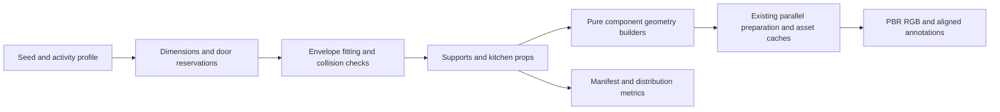

# Procedural kitchens and kitchenettes

`Kitchen` and `Kitchenette` are opt-in indoor activity profiles. They compose
seeded kitchen stations, storage, supported accessories and optional dining
areas inside the existing polygonal architectural envelope. The existing
`Mixed` sampling distribution is unchanged.

## Use

```sh
cargo run --bin viewer -- --scene-type procedural-indoor \
  --indoor-layout kitchen --indoor-seed 60
cargo run --bin indoor_validate -- --layout kitchenette --seed 0 \
  --audit-seeds 512 --audit-geometry --renders 32 --cameras 3 \
  --width 512 --height 512 --labels --co-visibility --no-raw \
  --output out/kitchenette_review
```

Scene Studio exposes both profiles under **Activity distribution**. Web URLs
accept `scene_type=procedural-indoor&indoor_layout=kitchen&indoor_seed=60` using
the existing URL round-trip contract. Apply the scene settings and regenerate
to build the selected profile.

```rust
use bevy_zeroverse::scene::procedural_indoor::{
    layout::{IndoorLayout, IndoorManifest},
    validation::{validate_geometry, validate_layout},
};

let scene = IndoorManifest::generate_with_humans(
    60, IndoorLayout::Kitchen, 0.65, 3, 0.25,
)?;
validate_layout(&scene)?;
validate_geometry(&scene)?;
```

For capture or JIT training, set `BevyZeroverseConfig.indoor_layout` and use the
existing capture/Burn interface. Kitchen generation introduces no model loader
or independent rendering path.

## Construction and sampled variation

| Category | Constructed variation |
|---|---|
| Sink stations | One/two basins, real worktop cutouts, inset bowls and drains, metal/ceramic finish, optional draining board/rack, dishes inside basins |
| Faucets | Curved gooseneck, squared spout, compact mixer, offset curved spout; single/twin controls; metric height and reach follow the station |
| Washing supplies | Independently sampled pump hand soap, squeeze dish soap and sponge; standalone dispensers and sponges can also occupy worktops |
| Cooking | Gas burners with pan supports or electric rings, front/rear/side cooktop controls, independent worktop cooktops and integrated ranges |
| Ovens | Under-counter or elevated built-in tower installation, single/double ovens, left/right/top controls, solid/glazed doors, downward-open doors, racks and trays |
| Microwaves | Left/right/bottom control panels, corresponding door apertures, open/closed doors, solid/glazed windows, turntable and optional dish |
| Dishwashers | Full cavity, loaded/empty racks, downward-open/closed door, predominantly solid fronts with occasional glazing |
| Refrigerators | Single/paired doors, solid/glazed fronts, open/closed state and opening angle, stocked/empty shelves, bottles/cartons, attached notes/pictures/magnets |
| Cupboards and pantry | Solid/glazed/open doors or open shelving; independently populated shelves, plates/bowls/mugs/cups/glasses, pantry jars/cartons/tins; lower cabinets and supported upper cupboards |
| Utensils | Knife block with varying knife count, hollow utensil crock with spoons/spatulas, cutting board, folded and handle-hung towels |
| Paper towels | Vertical pole/base or horizontal cradle, roll core and paper tail |
| Food and dishware | Hollow plate stacks/bowls/mugs/cups/glasses, fruit bowl or open basket with supported fruit, bread loaf with crust scores, optional bread on a board |
| Work surfaces | Coordinated cabinet-top runs, sink inset, optional freestanding island/perpendicular/parallel preparation station; shared worktop height and material family |
| Floor and dining | Hard wood/mineral work-area flooring, optional sink-side mats using the rug program; dining tables/chairs with kitchen dishware instead of workstation clutter |

Widths, depths, heights, worktop heights, door angles, seeds, materials and
accepted placements vary continuously within bounded construction programs.
The listed alternatives are conditional construction choices, not a count of
unique scenes or a claim about downstream training utility.

## Placement and correctness contract

Required sink/preparation stations are admitted transactionally. `Kitchen`
also requires a cooking range. Candidate runs first use actual envelope walls;
bounded inset attempts handle glazed or obstructed perimeters. Fitted carcasses
retain clearance from skirting, windows and door approaches. Optional appliances
are admitted at either end of the run; their absence and rejected requests are
recorded rather than hidden by dropping the seed.

Open doors reserve their full final envelope **before** placement, camera
sampling and human placement. Each door, handle and attached refrigerator note
uses the same hinge transform. Counter surfaces share a work plane; opening
space is recalculated when appliance height changes. Islands reserve additional
circulation space. This is static state sampling, not a door animation or
continuous door-sweep simulation.

Islands have a dedicated freestanding cabinet construction: 1.50–2.35 m wide,
0.92–1.18 m deep, with the shared 0.86–0.94 m worktop height. A continuous
28–47 mm slab overhangs the end panels and fronts; some samples add a deeper
rear breakfast overhang. Two to four drawer/door bays, finished rear panels
and a recessed plinth give the island a complete base from every viewpoint.
The collision envelope includes the slab, and prop support uses its actual
footprint. Islands remain on the service run's floor level, with 0.90 m of
level circulation clearance around the full envelope. Bounded nearby placement
attempts may recover a position; an incompatible floor recess or step rejects
the optional island rather than lowering the cabinet into it.

Worktop items use the normal support and peer-clearance checks. Bread on a board
has a nested support relationship. Internal contents use shelf/basin/holder
coordinates; cabinet fronts and glass panes contain actual apertures. A
triangle-level sink ray test detects a concealed panel closing the bowl.

## API, semantics and metrics

`objects::kitchen::{dimensions, parameters, island_parameters, metadata}` expose deterministic
construction parameters. `manifest.assembly_diagnostics.kitchens` records the
accepted unit/prop IDs, requested units, rejected optional units, composition,
wall fitting and worktop height. Each object retains its geometry/finish seed.

The object catalog contains 21 kitchen kinds. The kitchen extension appends
`stove`, `oven`, `microwave`, `dishwasher`, `faucet`, `dishware`,
`kitchen_utensil`, `food`, `soap_dispenser` and `cleaning_supply`. Existing label
IDs/colors stay stable. Counter, sink, refrigerator, cabinet, towel, glass and
paper use their existing labels. New parts retain their own semantic labels
instead of being relabeled as one appliance class.
Glazed appliance and cupboard doors retain their appliance/cabinet class;
the glass material does not turn them into architectural `window` labels.

The parent appliance owns the instance ID of its embedded parts and contents;
standalone accessories own separate IDs. Thus an internal dish can have a
`dishware` pixel label while belonging to a refrigerator/cupboard instance.
Instance OBBs describe constructed geometry; placement bounds also reserve door
clearance. Existing depth, position, normals, optical flow, co-visibility,
schematic and primary-room voxel export use the same production geometry and
the shared annotation-glass policy.

`indoor_validate` exports the ordinary object count distributions, heatmaps,
camera/annotation diagnostics and additional `kitchen_*` parameter metrics.
Numeric fields describe sampled dimensions/counts/angles; category fields
describe materials/states. Requested/accepted counts expose placement bias.
The spatial-diversity sketch uses enough mask words for the whole catalog;
categories above 63 neither overflow nor alias existing categories.

## Pipeline and cost controls



Builders are split into cabinets, sinks, appliances and props. Round components
use welded tube sweeps with bounded cross-sections, avoiding overlapping joints
and internal caps along sampled curves. Builders emit into
the existing material/semantic batching and scene preparation pipeline. The
usual GPU material synthesis remains active. Food adds at most five small
64×64 color maps with mipmaps, synthesized only when referenced; it reuses the
existing PBR map families and symbolic transport resolver. No mesh/image
downloads are introduced. Geometric complexity and placement attempts are
bounded per item.

`indoor_bench --layout kitchen` measures completed captures through the same
headless path. Use three 512×512 views, ordinary quality, annotations and
co-visibility when comparing throughput; do not substitute a reduced-shadow
render or CPU-only construction time for completed generation throughput.

## Qualification

Qualification uses actual mesh bounds/topology, support and collision checks,
the sink ray oracle, conditional parameter coverage, selected/full PBR map
equality, and native RGB with aligned annotations. Controlled object galleries
are generated by `examples/review_kitchens.rs`; real room cohorts use
`indoor_validate`. These distinguish construction diversity from dimensions,
palette and camera changes.

Local island qualification is recorded under
`out/kitchen_qualification/islands/`. The current cohort contains 256 consecutive
mesh audits per profile with no invalid rooms or degenerate triangles, and
16 captured rooms per profile: 32 rooms, 96 calibrated views at 512×512, with
RGB, depth, normal, position, semantic and co-visibility outputs. It admits 72
islands across the 512 audited rooms. Four additional front/rear captures show
the dedicated island construction. Fourteen focused kitchen regressions cover
actual slab heights and holes, metric bounds, level walking clearances, narrow
steps, support, parameter coverage, replay and semantics. Native rendering
uses Vulkan on an RTX PRO 6000 Blackwell. Clippy with warnings denied and WASM
viewer compilation with motion features pass; browser runtime rendering is
not qualified by this cohort.

The local report binds captures, metrics and construction parameters to a
single source fingerprint. The island mesh is bounded below 10,000 triangles
and reuses the existing rendering passes and batching. The island cohort is a
correctness review, not an isolated throughput benchmark. Rendered correctness
is qualified for the tested adapter and seeds, not a proof of
photographic realism, all possible seeds, or 10M-sample learning utility.
Built-in towers represent wall ovens; there is no structural building-code or
plumbing simulation.
