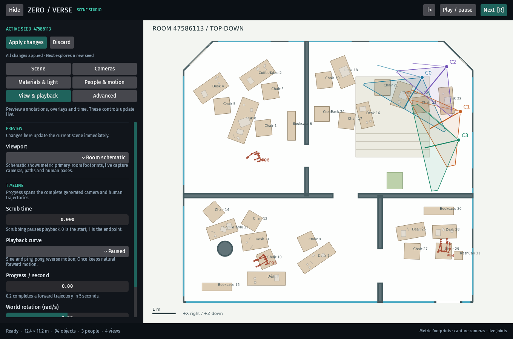
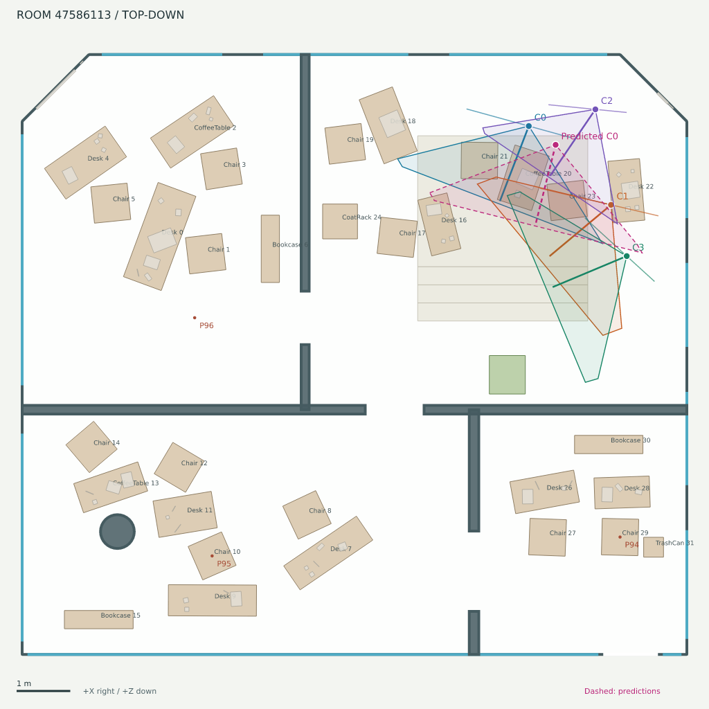

# Room schematics



Choose **View & playback → Viewport → Room schematic** in the native or WebGPU
viewer. Editor camera and Capture grid remain available in that selector.
`?room_schematic=true&scene_type=procedural-indoor` selects it in a shared link;
the viewer updates the URL when the selection changes. Use the timeline to inspect
camera and human poses at another trajectory position. The live schematic uses Bevy's GPU 2D renderer on native and WebGPU. Room
geometry and labels are retained; playback updates a small camera/pose mesh at
viewer frame rate. It does not rasterize SVGs or upload full images each frame.
Paused diagrams reuse their meshes. Switching away releases the schematic's
camera, image, meshes, materials and labels. Dataset SVG/PNG exports keep their
deterministic CPU renderer and require no GPU initialization.

The diagram shows the primary-room envelope, windows, partitions and openings,
floor levels, mezzanine/stairs, columns, oriented furniture and prop bounds,
plants, capture cameras, lens footprints, trajectories, and human skeletons.
It omits ceilings and neighboring geometry. Furniture polygons are bounds, not
mesh silhouettes. Camera lens footprints have a finite display length; they do
not indicate measured co-visibility or occlusion. Use the co-visibility annotation
for that purpose. Plans generated from a manifest alone show person positions;
captured samples and the viewer show actual skeletons.

Camera labels identify **pinhole** or **fisheye** in both the live schematic and
SVG/PNG exports. Fisheye markers use a lens ring with a central dot; their label
also gives the calibrated angular-domain diameter (for example, `fisheye 200°`).
This is not a pinhole horizontal/vertical FOV. Circular, full-frame and elliptical
sensors use their actual calibration and valid rays for the curved display hull,
including rays behind the camera for domains above 180°. Ceiling-facing optical
axes are labeled `down` (or `up`), since their direction collapses in a top-down
projection. Prediction overlays retain the same lens markers and camera-ID colors
with dashed outlines.
The JSON keeps the full versioned calibration and the original camera label.
Run `cargo run --example schematic -- --lenses` for mixed-room exports and a lens
comparison diagram. `cargo run --example review_schematic -- --lenses` checks
the native mixed-lens schematic and saves its screenshot under
`out/schematic/lens-ui/`.

Use **Camera glyph size · schematic** in the Studio's Room schematic viewport to
scale camera symbols from **0.1× to 4×** (default **1×**). The viewer CLI flag is
`--schematic-camera-gizmo-scale`, and the URL parameter is
`schematic_camera_gizmo_scale`. This changes camera and prediction glyphs, including
their lens rings, without changing the metric room projection or trajectory paths.
The editor's 3D glyphs have a separate `camera_gizmo_scale` setting. Both update
live without scene regeneration; the schematic retains its render target and
background geometry while the slider moves.

## Dataset export

```sh
cargo run -p bevy_zeroverse_burn --bin zeroverse_gen -- \
  --scene-type procedural-indoor --output out/rooms --samples 3 \
  --cameras 3 --width 512 --height 512 --playback-steps 1 --schematic
```

Add `--schematic-camera-gizmo-scale 0.5` for smaller symbols in exported sidecars.
This works with both folder and chunk outputs and supervised child processes.
Non-default exported sizes are recorded in the resume configuration.

The optional export writes one JSON/SVG/PNG triplet per timestep under
`schematics/sample_000000/000.*` for folder output, or
`schematics/chunk_000000/0000/000.*` for chunk output (chunk, sample within chunk,
timestep). Its capture and resume configuration records whether schematics were
requested. Existing sample tensors and render-mode channels are unchanged.
Rendering runs on the export thread after scene, camera and motion readiness;
it needs no extra GPU renders. With export disabled, no schematics are built.

## Rust API and prediction overlays

```rust,ignore
use bevy_zeroverse::annotation::schematic::{Overlay, RenderOptions};
let plan = sample.schematic(0)?; // recorded camera/pose matrices at timestep 0
let mut predictions = Overlay::default();
predictions.cameras.push(predicted_camera); // world-space Camera
predictions.poses.push(predicted_pose);     // joints + parent indices
let options = RenderOptions { camera_gizmo_scale: 0.5, ..Default::default() };
plan.write("out/calibration", options, predictions)?;
```

`RenderOptions::camera_gizmo_scale` is also available to native/Wasm API callers.
It scales compact symbols and opt-in full display frustums; it does not change
`Camera::world_from_view`, calibration, paths or the exported metric `Projection`.
The chosen scale is recorded in the schematic document's `options`.

`Schematic::svg`, `rgba`, and `document` also work without a filesystem on Wasm.
`Schematic::from_manifest` supports CPU-only layout audits. See
[`examples/schematic.rs`](../examples/schematic.rs) for a runnable prediction
example. Applications may insert `app::editor::schematic::Predictions` to display
model outputs in the viewer. Camera predictions use dashed lines in the matching
capture camera's color: include its ID in the label, for example `Pred C7`.
Sparse or reordered predictions retain their camera colors. Other predicted
objects and poses use magenta; their outliers are
clipped to the map viewport and never expand the ground-truth metric extent.

Coordinates use world-space metres, +Y up. The view looks down onto X/Z: +X is
right, +Z down. Camera transforms are column-major `world_from_view`, -Z forward,
+Y up. Optional full `CameraCalibration` takes precedence over fov/aspect when
projecting image-plane corners or fisheye rays. JSON includes the complete editable scene, overlays, render options and
`Projection`: `u = scale*x + offset[0]`, `v = scale*z + offset[1]`. Coordinates
refer to pixel boundaries; pixel centers are `(i+0.5, j+0.5)`. `project` and
`unproject` supply the exact mapping; unprojection needs an explicit world height.
The JSON records normalized trajectory progress and physical time when available.


